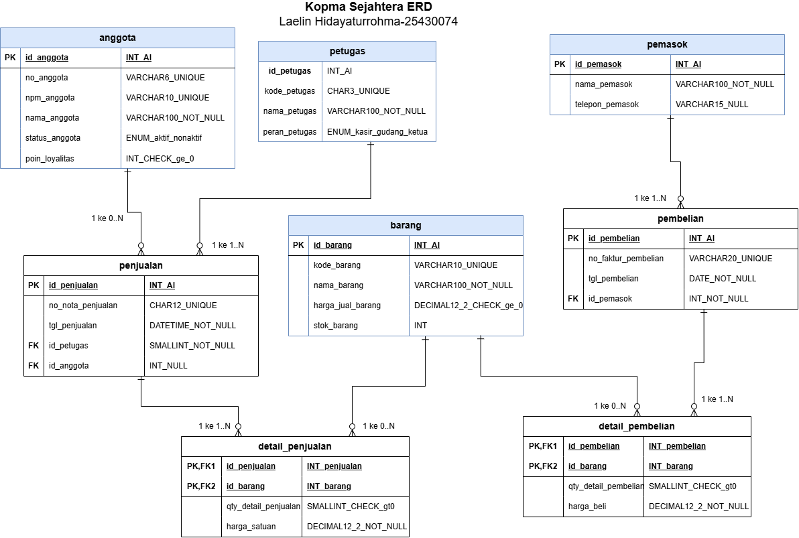
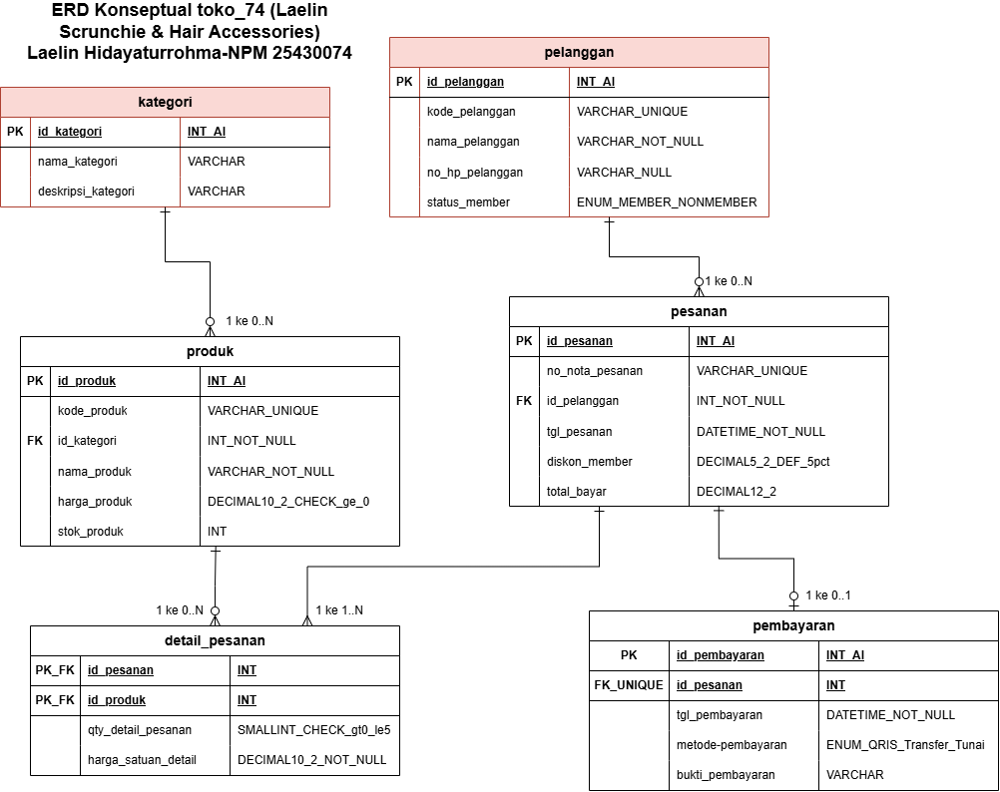

# Identitas Mahasiswa

Nama: Laelin Hidayaturrohma

NPM: 25430074

Kelas: C

Mata Kuliah: Basis Data

Dosen Pengampu: Dedi Irawan, S.Kom, M.T.I

Program Studi: Ilmu Komputer

Fakultas: Ilmu Komputer

Instansi: Universitas Muhammadiyah Metro (2026)

# 1. Tujuan Praktikum

1. Mengenali mana yang termasuk entitas, entitas asosiatif, serta atribut kunci (primary key, alternate key, dan foreign key) dari berkas kebutuhan data.
2. Menentukan hubungan atau relasi beserta batas kardinalitas antar-entitas sesuai dengan aturan bisnis organisasi.
3. Merancang diagram ERD konseptual menggunakan standar notasi Crow's Foot melalui aplikasi draw.io.
4. Mengecek dan memvalidasi hasil desain ERD terhaadap Kebutuhan Informasi (KI), serta menyesuaikan berdasarkan masukan dari analisa klien.

# 2. Alat dan Bahan

- Berkas kebutuhan data serta aturan Kopma Sejahtera dari pengerjaan Modul 2.
- Aplikasi pembuat diagram draw.io
- Text editor untuk menulis dan mengedit laporan berformat Markdown (.md), seperti VS Code.
- Repositori Git 'basisdata-25430074' dari praktikum sebelumnya.

# 3. Ringkasan Dasar Teori

Rancangan model data konseptual memakai Entity-Relationship Diagram  (ERD) adalah jembatan penting untuk menghubungkan analisis kebutuhan nyata di lapangan dengan struktur tabel di basis data relasional. Lewat ERD, kita bisa melihat gambaran jelas mengenai entitas, atribut, dan bagaimana entitas tersebut saling berhubungan.
Pada notasi Crow's Foot, kardinalitas dipakai untuk menunjukkan berapa banyak data pada satu entitas yang bisa terhubung ke entitas lainnya (mulai dari batas paling sedikit 0 atau 1, sampai batas paling banyak 1 atau N/banyak). Agar proses pencarian data (indexing) dan penggabungan tabel (join) di dalam sistem berjalan cepat, sangat disarankan memakai "surrogate key" berupa angka integer sebagai Kunci Primer (PK). Selain itu, relasi banyak-ke-banyak (M:N) perlu dipecah memakai entitas asosiatif supaya data transaksi-seperti jumlah barang yang dibeli dan catatan harga saat transaksi terjadi bisa tersimpan dengan rapi tanpa ada yang hilang.

# 4. Hasil Langkah Percobaan 

Berikut adalah rangkuman dari pengerjaan langkah percobaan D.1 sampai D.4 pada Modul 3 ini:

| Langkah | Hasil | Tangkap Layar |
|---|---|---|
| D.1 Dari Entitas Kandidat ke Entitas | Berhasil memisah entitas 'PEMBELIAN' & 'DETAIL_PEMBELIAN' serta menentukan PK dan FK-nya |  |
| D.2 Relasi dan Kardinalitas | Menentukan batas kardinalitas dan merapikan Tabel 3.2 Relasi Kopma |  |
| D.3 Menggambar ERD Kopma | Menggambar ERD Konseptual notasi Crow's Foot lengkap di canvas draw.io |  |
| D.4 Validasi ERD & Tinjauan Klien | Memetakan Kebutuhan Informasi (KI-01 sampai KI-05) serta mencatat masukan revisi |  |

# 5. Jawaban Titik Analisis

Titik Analisis 1 - Kenapa Memilih Surrogate Key 'id_anggota'?
- Alasan Pemilihan PK: 'id_anggota' dipakai sebagai "surrogate key" dengan tipe data angka (integer). Penggunaan kunci berupa angka membuat proses pencarian data (indexing) dan relasi antar-tabel di dalam sistem basis data bekerja jauh lebih cepat ketimbang memakai teks/string.
- Risiko kalau NPM dipaksa jadi Kunci Primer: 
1. Anggota Non-Mahasiswa: Anggota Kopma tidak semuanya mahasiswa aktif. Ada juga staf atau masyarakat umum yang tidak akan bisa dimasukkan ke sistem. 
2. Data Bisa Berubah: NPM punya potensi berubah akibat alasna administratif akademis. Kalau NPM dijadikan PK, perubahan ini bakal memicu perubahan berantai (cascading update) pada semua riwayat transaksi yang pernah dibuat.

Titik Analisis 2 - Batasan Kardinalitas Pemaksa 
- Aturan Bisnis Pemaksa: AB-01 (Setiap nota penjualan wajib berisi minimal satu item barang yang dibeli).
-Penjagaan Lewat Tabel: Batasan "minimal satu" ini tidak bisa dijaga cuma dari struktur tabel (DDL) biasa saat membuat "header" nota. Aturan ini harus ditangani lewat mekanisme transaksi basis data ('COMMIT'/'ROLLBACK'), "trigger", atau dibuatkan validasi khusus di aplikasi kasir.

Titik Analisis 3 - Pencatatan Petugas Penerima Barang Pembelian
- Apakah ERD Awal Bisa Menjawab? Belum bisa, karena entitas 'PEMBELIAN' dan ERD awal cuma terhubung ke entitas 'PEMASOK'.
- Solusi Relasi & Aturan Baru: Kita perlu menambah relasi baru antara 'PETUGAS' dan 'PEMBELIAN', lalu mencatatnya sebagai aturan bisnis baru "AB-07" (Setiap transaksi pembelian atau penerimaan barang dari pemasok wajib dicatat oleh tepat satu petugas gudang).

# 6. Hasil Latihan dan Modifikasi

E.1 Analisis Poin Loyalitas Anggota
- Keputusan:
1. Atribut 'poin_loyalitas' di entitas 'ANGGOTA': Digunakan untuk menyimpan total saldo poin aktif yang dimiliki anggota saat ini.
2. Entitas Tambahan ('RIWAYAT_P0IN'): Perlu dibuat kalau sistem ingin mencatat jejak riwayat (audit trail) kapan poin didapat dari belanja dan kapan poin dipakai untuk penukaran.
- Alasan: Kalau cuma simpan di entitas 'ANGGOTA', kita tidak bisa melacak histori transaksi asal-usul poin tersebut.

E.2 Relasi Penjualan-Barang Secara Langsung (Direct M:N)
- Visualisasi Relasi: 'PENJUALAN' (1..N) <---> (1..N) 'BARANG' 
- Data yang Bakal Hilang:
1. 'qty_detail_penjualan': Jumlah unit barang yang dibeli per item dalam satu transaksi.
2. 'harga_satuan_detail_penjualan': Catatan harga historis barang saat transaksi terjadi (karena harga di tabel barang utama bisa saja naik/turun di masa depan).

# 7. Tugas Mandiri: Milestone Proyek 3 ('toko_74 - Laelin Scrunchie & Hair Accessories')

Berkas Laporan & Diagram: 'p03_erd_25430074.drawio' dan 'p03_erd_25430074.png' (Toko Aksesori: Laelin Scrunchie & Hair Accessories/'toko_74')

| Ketentuan Minimum | Parameter NPM 74 | Hasil Implementasi |
|---|---|---|
| Batas Item Pembelian ($N_1$) | $74 \pmod 9 + 1 + 2 = 5$ | Dibatasi maksimal 5 varian produk dalam satu pesanan |
| Diskon Member ($N_2$) | $5\%$ | Member terdaftar mendapat potongan diskon 5% |
| Transaksi Harian ($N_3$) | 34 Transaksi/hari | Desain tabel siap menangani rata-rata 34 transaksi sehari |
| Kelengkapan Entitas | Minimal 5 Entitas | Memiliki 5 Entitas Utama (`PELANGGAN`, `KATEGORI`, `PRODUK`, `PESANAN`, `PEMBAYARAN`) + 1 Entitas Asosiatif (`DETAIL_PESANAN`) |
| Penelusuran KI | KI-01 sampai KI-04 | Semua jalur kebutuhan informasi bisa ditelusuri dengan lancar pada ERD |

Tabel Relasi dan Kardinalitas Proyek Mandiri ('toko_74')
| Relasi| Sisi Kiri| Sisi Kanan| Dasar (Aturan Bisnis/ Parameter NPM) |
|---|---|---|---|
| Pelanggan membuat pesanan | Nol atau satu pelanggan| Nol atau banyak pesanan | Pembeli umum/member toko_74|
| Kategori mencakup produk| Tepat satu kategori| Satu atau banyak produk| Katalog varian scrunchie toko_74|
| Produk terdapat pada detail_pesanan| Tepat satu produk| Nol atau banyak detail| Stok katalog produk|
| Pesanan berisi detail_pesanan| Tepat satu pesanan| Satu atau banyak detail| Dibatasi N1 = maks 5 item/pesanan|
| Pesanan memiliki pembayaran| Tepat satu pesanan| Nol atau satu pembayaran| Verifikasi transaksi & konfirmasi|

Gambar ERD Proyek Mandiri ('toko_74')

# 8. Pembahasan dan Kendala

Pas pengerjaan Modul 3 iini, tantangan yang cukup terasa adalah menentukan kardinalitas minimum dan maksimum pada relasi yang punya sifat opsional (seperti pembeli umum yang tidak terdaftar sebagai member). Masalah ini bisa diselesaikan setelah membaca kembali catatan aturan bisnis dari Modul 2. Selain itu, fungsi penting dari entitas asosiatif jadi makin terasa pas menganalisis apa dampaknya kalau entitas transaksi langsung dihubungkan ke entitas barang tanpa tabel peranta.

# 9. Kesimpulan

1. Desain ERD Konseptual berstandar notasi Crow's Foot berhasil menggambarkan seluruh entitas, atribut kunci, dan relasi untuk kasus Kopma Sejahtera maupun proyek 'toko_74'.
2. Pemakaian "surrogate key" angka terbukti lebih aman dan efisien memaksakan Kunci Alami ("natural key") seperti NPM.
3. Entitas asosiatif ('DETAIL_PENJUALAN'/ 'DETAIL_PESANAN') memang wajib ada supaya data jumlah belanjaan dan harga saat transaksi tidak hilang.

# Bukti ERD Konseptual

# 1. ERD Kopma Sejahtera (Studi Kasus Terbimbing)

# 2. ERD Toko Scrunchie (Proyek Mandiri NPM 74)

# 10. Pernyataan Penggunaan AI

Saya memanfaatkan alat bantu AI untuk teman diskusi saat mengecek kebenaran notasi Crow's Foot, membantu menyusun draf kalimat penjelasan analisis agar mudah dipahami, dan merapikan tampilan tabel Markdown. Semua rancangan diagram ERD, isi atribut, dan penerapan parameter NPM 74 saya kerjakan dan cek sendiri secara mandiri.

# 11. Bukti Git

- Repositori: 'https://github.com/laelinhdytrhma18-cell/basisdata_25430074'
- Hash commit: 55ce4bf2c90d65d892556a7e0bc11b4da89ba1e9

# Checklist

- [x] Berkas `p03_erd_kopma_25430074.drawio` & `p03_erd_kopma_25430074.png` sudah tersimpan di folder laporan
- [x] Berkas `p03_erd_25430074.drawio` & `p03_erd_25430074.png` (Milestone toko_74) sudah lengkap
- [x] Format laporan tersusun rapi dari bagian 1 sampai 11 sesuai standar
- [x] Titik Analisis 1, 2, dan 3 sudah dijawab dengan jelas
- [x] Pertanyaan Latihan E.1 dan E.2 sudah dibahas
- [x] Semua berkas sudah berhasil di-*commit* dan di-*push* ke GitHub