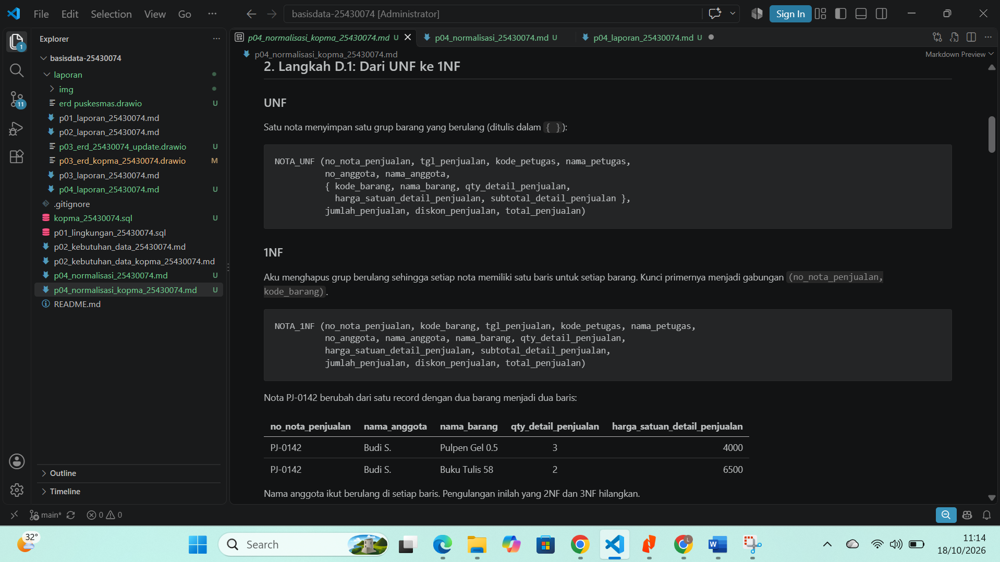
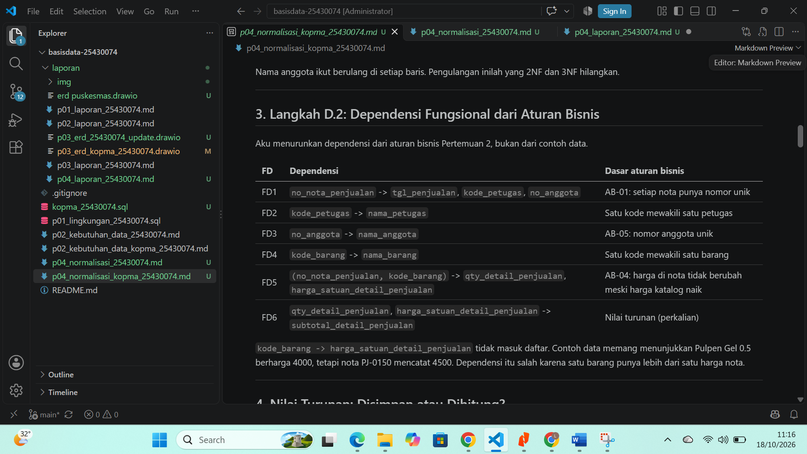
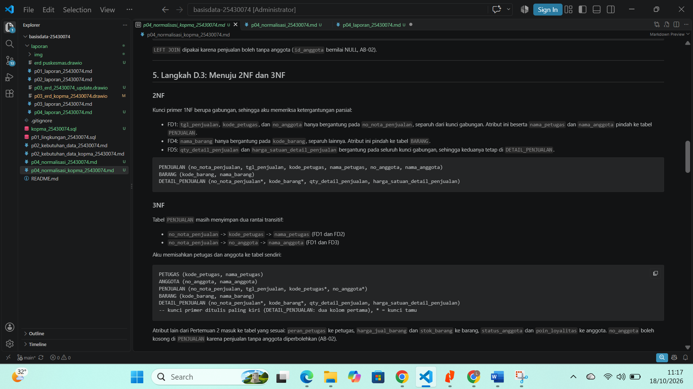
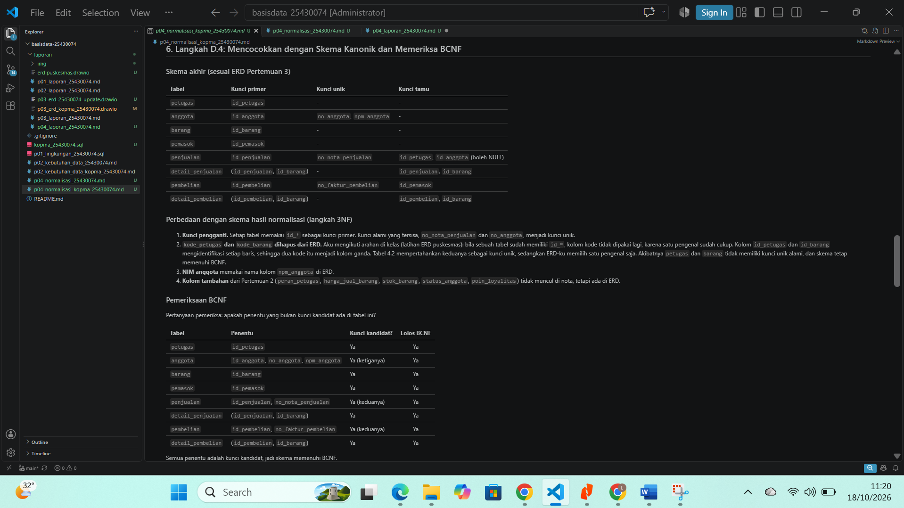
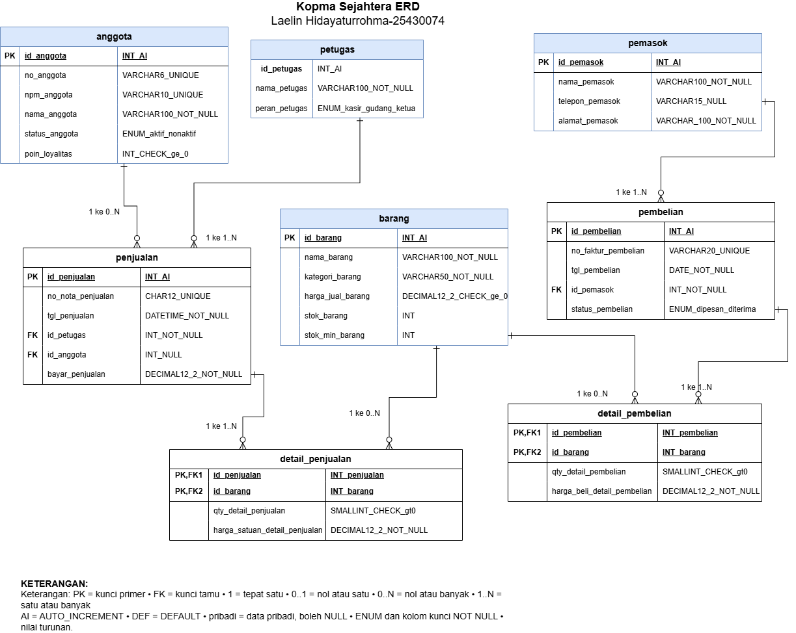
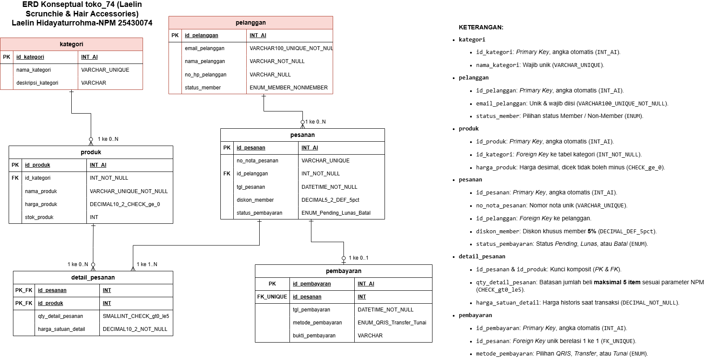
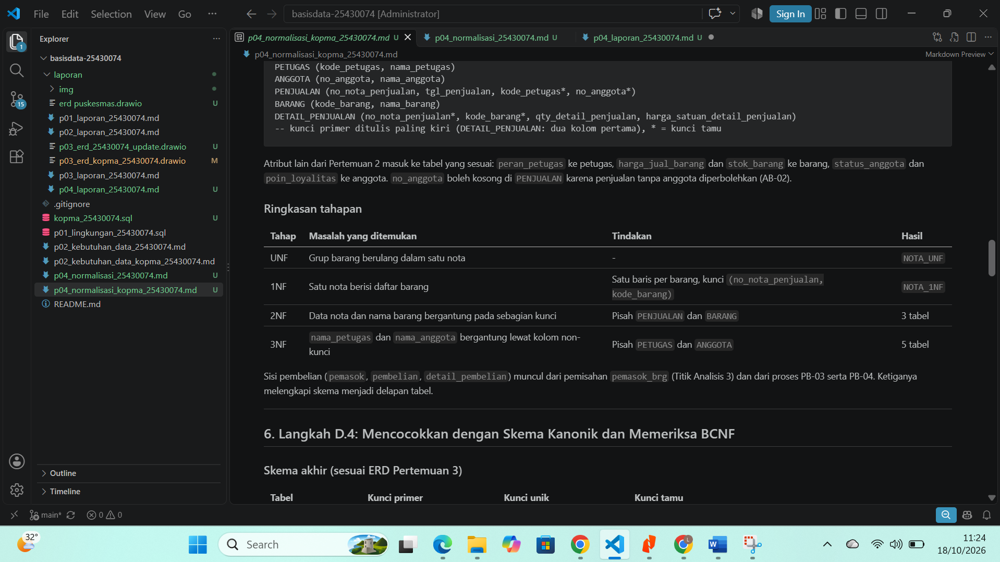
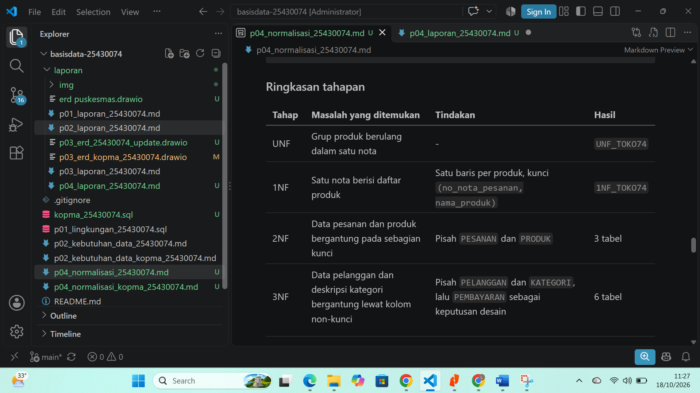

# Identitas Mahasiswa

Nama: Laelin Hidayaturrohma
NPM: 25430074
Kelas: C
Mata Kuliah: Basis Data
Dosen Pengampu: Dedi Irawan, S.Kom, M.T.I
Program Studi: Ilmu Komputer
Fakultas: Ilmu Komputer
Instansi: Universitas Muhammadiyah Metro (2026)

# 1. Tujuan Praktikum

1. Mengidentifikasi anomali ubah, sisip, dan hapus pada data yang belum dinormalisasi.
2. Menuliskan dependensi fungsional dari aturan bisnis.
3. Menormalisasi relasi hingga bentuk normal ketiga (3NF) dan memeriksa BCNF.
4. Memutuskan penyimpanan nilai turunan dan mendokumentasikan skema relasional akhir.

# 2. Alat dan Bahan

- Spreadsheet lama Kopma pada modul (Gaambar 4.1)
- ERD Kopma dan ERD proyek 'toko_74' dari pertemuan 3.
- Editor Markdown (VS Code) dan aplikasi draw.io.
- Repositori Git 'basisdata_25430074'.

# 3. Ringkasan Dasar Teori

Normalisasi menghilangkan tiga anomali pada tabel besar. Anomali ubah terjadi ketika satu fakta tersimpan di banyak baris dan salah satunya berbeda. Anomali sisip terjadi ketika fakta baru tidak bisa dicatat sebelum fakta lain ada. Anomali hapus terjadi ketika menghapus satu fakta ikut menghapus fakta lain.

Atribut B bergantung secara fungsional pada atribut A (A -> B) bila setiap nilai A menentukan tepat satu nilai B. Saya menurunkan dependensi dari aturan bisnis. Contoh data hanya menguji hasilnya.

| Bentuk | Syarat |
| :--- | :--- |
| 1NF | Semua nilai atomik dan tidak ada grub berulang |
| 2NF | 1NF dan tidak ada atribut non-kunci yang bergantung pada sebagian kunci komposit |
| 3NF | 2NF dan tidak ada atribut non-kunci yang bergantung pada atribut not-kunci lain |
| BCNF | Setiap penentu adalah kunci kandidat |

Nilai turunan, seperti subtotal dan total, dapat dihitung dari data lain. Tabel operasional tidak menyimpannya agar tidak menyimpang dari rincian transaksi. Kunci pengganti ('id_*') tidak menggantikan pemeriksaan dependensi fungsional. Kunci alami tetap menjadi kunci unik.

# 4. Hasil Langkah Percobaan

| Langkah | Hasil | Tangkap Layar |
|---|---|---|
| D.1 Dari UNF ke 1NF | Menulis 'NOTA_UNF' dengan grub barang berulang, lalu menghapus grub itu. Kunci primer menjadi '(no_nota_penjualan, kode_barang)'. |  |
| D.2 Dependensi Fungsional | Menurunkan FD1 sampai FD6 dari aturan bisnis (AB-01, AB-04, AB-05). |  |
| D.3 Menuju 2NF dan 3NF | 2NF memisahkan 'PENJUALAN' dan 'BARANG'. 3NF memisahkan 'PETUGAS' dan 'ANGGOTA'. Saya menghitung nilai turunan (subtotal, jumlah, diskon, total) lewat kueri. |  |
| D.4 Mencocokkan Skema Kanonik | Skema akhir memiliki 8 tabel dengan kunci pengganti 'id_*'. Semua penentu adalah kunci kandidat, sehingga skema memenuhi BCNF. |  |

Catatan ERD Kopma: normalisasi tidak mengubah struktur tabel. Saya mengubah satu hal, yaitu tipe 'penjualan.id_petugas' dari SMALLINT menjadi INT agar sama dengan 'petugas.id_petugas'.

# 5. Jawaban Titik Analisis

**Titik Analisis 1: Mengapa FD5 menempatkan 'harga_satuan_detail_penjualan' pada kunci '(no_nota_penjualan, kode_barang)'?**
- Harga nota adalah fakta tentang satu barang pada satu transaksi (AB-04). Pulpen Gel 0.5 terjual Rp4000 pada nota PJ-0142 dan Rp4.500 pada nota PJ-0150, sehingga 'kode_barang' saja tidak menentukan harganya.
- Bila kolom harga pindah ke tabel 'barang', nota PJ-0142 (3 pulpen) berubah dari Rp12.000 menjadi Rp13.000 setelah harga katalog naik. Omzet lama naik Rp1.500 untuk satu baris, padahal uang yang Kopma terjamin tetap sama.

**Titik Analisis 2: Mengapa keputusan "total tidak disimpan" berbeda untuk arsip penjualan?**
- Tabel operasional menghitung total dari sumbernya karena qty, harga barang, dan status anggota masih bisa berubah. Total yang tersimpan akan menyimpang dari rincian nota.
- Arsip menyimpan potret periode yang sudah ditutup. Nilainya tidak boleh berubah walau status anggota atau aturan diskon berubah. Dua keputusan itu konsisten: data yang masih berubah dihitung, potret historis disimpan.

**Titik Analisis 3: Di mana informasi pemasok barang kini disimpan?**
- Informasi itu tersimpan lewat jalur 'barang' -> 'detail_pembelian' -> 'pembelian' -> 'pemasok'.
- Keuntungannya: satu barang bisa punya banyak pemasok, nama pemasok tersimpan sekali, pemasok baru bisa dicatat tanpa transaksi, dan menghapus nota penjualan tidak menghapus info pemasok.

# 6. Hasil Latihan dan Modifikasi

**E.1 Beberapa nomor telepon untuk pemasok**
- Satu kolom yang berisi banyak nomor melanggar 1NF. Saya membuat tabel anak 'telepon_pemasok' (id_pemasok*, no_telepon_pemasok)' dengan kunci primer gabungan, lalu menghapus kolom telepon dari 'pemasok'
- Relasinya 1:N: satu pemasok memiliki nol atau banyak nomor telepon.

**E.2 'nama_anggota' di tabel penjualan**
- Rantai 'id_penjualan' -> 'id_anggota' -> 'nama_anggota' adalah ketergantungan transitif, sehingga menlanggar 3NF. 
- Kueri 'UPDATE penjualan SET nama_anggota = 'Budi Santoso' WHERE no_nota_penjualan = 'PJ-0150' menyisakan nota PJ-0142 dengan nama "Budi S.". Kueri 'GROUP BY id_anggota HAVING COUNT (DISTINICT nama_anggota) > 1' menunjukkan anggota 7 memiliki dua versi nama.

Gambar ERD Kopma Setelah Diupdate: 

# 7. Tugas Mandiri: Milestone Proyek 4 ('toko_74' - Laelin Scrunchie & Hair Accessories)

Berkas: 'p04_normalisasi_25430074.md' dan ERD terbaru 'p03_erd_25430074.drawio'.

| Ketentuan Milestone | Hasil |
|---|---|
| Dokumen sumber | NOTA-20261004-074 dari p02 sebagai titik awal UNF |
| Dependensi fungsional beserta aturan bisnis | FD-01 sampai FD-07, masing-masing dengan dasar AB |
| Tahapan UNF, 1NF, 2NF, 3NF | Dokumen berisi contoh data nota dan menghasilkan 6 tabel. |
| Pemeriksaan BCNF | Semua penentu adalah kunci kandidat |
| Keputusan nilai turunan | Saya menghitung subtotal, total sebelum diskon, nilai diskon, dan total bayar lewat view 'v_total pesanan'. Aku menyimpan presentase diskon dan harga satuan nota karena keduanya fakta saat transaksi. |
| Pembaruan ERD | Saya mencatat lima perubahan di bagian 8 dokumen normalisasi |

Skema akhir: 

| Tabel | Kunci Primer | Kunci unik | Kunci tamu |
| :--- | :--- | :--- | :--- |
| 'kategori' | 'id_kategori' | 'nama_kategori' | - |
| 'pelanggan' | 'id_pelanggan' | 'email_pelanggan' | - |
| 'produk' | 'id_produk' | 'nama_produk' | 'id_kategori' |
| 'pesanan' | 'id_pesanan' | 'no_nota_pesanan' | 'id_pelanggan' |
| 'detail_pesanan' | ('id_pesanan', 'id_produk') | - | 'id_pesanan', 'id_produk' |
| 'pembayaran' | 'id_pembayaran' | id_pesanan' | 'id_pesanan' |

Gambar ERD proyek setelah pembaruan: 

# 8. Pembahasan dan Kendala 

- Saya memilih menggunakan salah satu dari id_* dan kode_*, saya memilih menggunakan id_*, sehingga nota toko tidak memuat kode pelanggan atau kode produk, saya harus menentukan kunci alami sendiri (email pelanggan dari AB-01 data nama produk dari katalog).
- Contoh data hanya menunjukkan satu harga untuk satu produk, tetapi dependensi 'kode_barang -> harga' salah karena harga nota bisa berbeda dari harga katalog.
- Memutuskan nilai turunan: 'total_bayar' awalnya tersimpan di ERD 'pesanan', lalu aku hapus dan hitung lewat view.

# 9. Kesimpulan

Normallisasi dari UNF sampai 3NF menghilangkan anomali ubah, sisip, dan hapus pada spreadsheet lama Kopma. Skema akhirnya memenuhi BCNF.
Dependensii fungsional harus berasal dari aturan bisnis. Contoh data saja menghasilkan dependensi yang salah, seperti harga barang yang tampak ditentukan oleh kode barang.
Tabel operasional tidak menyimpan nilai turunan. Fakta saat transaksi, seperti harga satuan nota dan presentase diskon, tetap disimpan.

# Bukti Tahapan Normalisasi

## 1. Kopma Sejahtera (Studi Kasus Terbimbing)

## 2. Toko Scrunchie (Proyek Mandiri)

# 10. Pernyataan Penggunaan AI

Saya memakai alat bantu AI untuk menyusun draf dokumen normalisasi, menguji kueri SQL, dan merapikan tabel Markdown. Saya membaca hasilnya, mencocokkannya dengan soal Modul 4 dan ERD saya, lalu menyesuaikan isinya.

# 11. Bukti Git

- Repositori: 'https://github.com/laelinhdytrhma18-cell/basisdata_25430074'
- Hash commit: `70fd363`

# Checklist

- [x] Berkas `p04_normalisasi_kopma_25430074.md` sudah tersimpan di folder laporan
- [x] Berkas `p04_normalisasi_25430074.md` (proyek) sudah tersimpan di folder laporan
- [x] Bukti tangkapan layar tahapan UNF, 1NF, 2NF, 3NF sudah ditambahkan
- [x] Daftar dependensi fungsional dan keputusan nilai turunan beserta alasannya sudah ada
- [x] Titik Analisis 1, 2, dan 3 sudah dijawab
- [x] Latihan E.1 dan E.2 sudah dibahas
- [x] ERD proyek sudah diperbarui dan perubahannya dicatat
- [x] Semua berkas sudah di-*commit* dan di-*push* ke GitHub