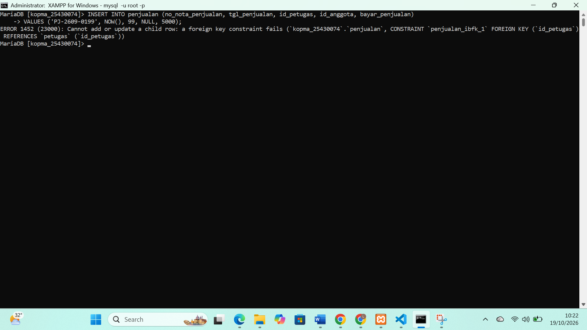
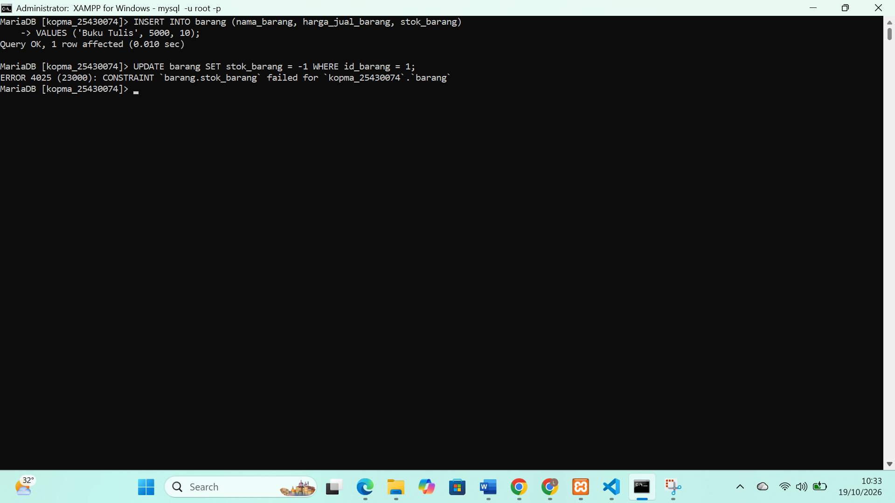
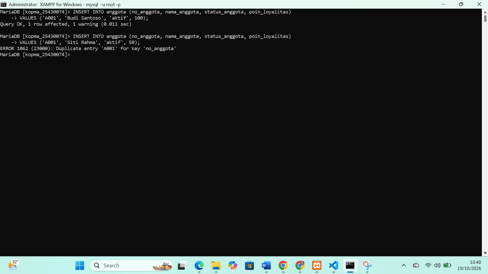
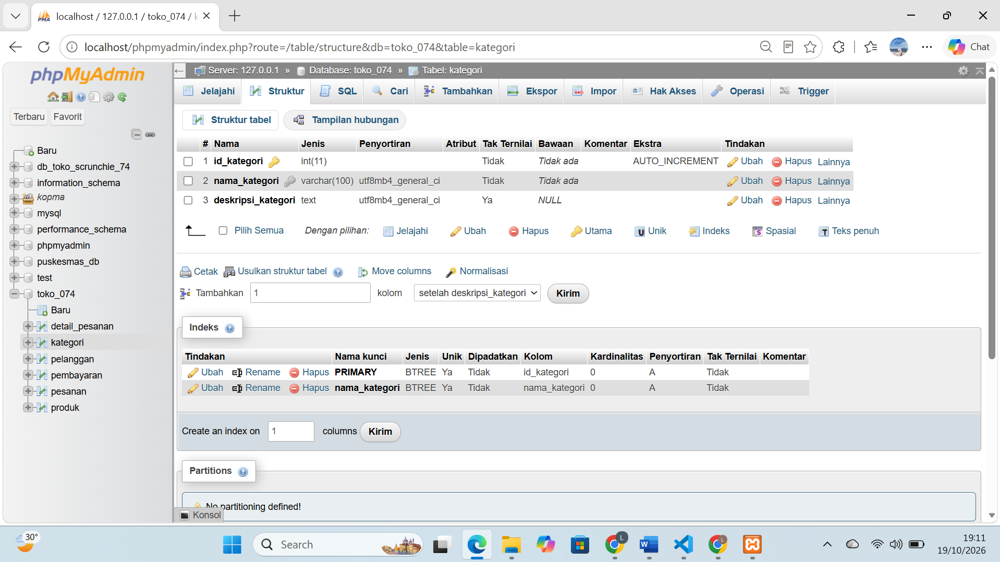
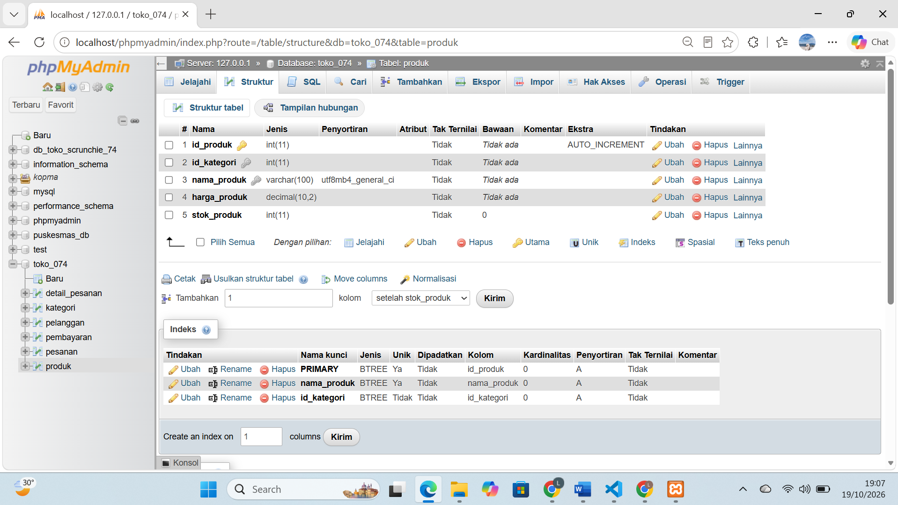
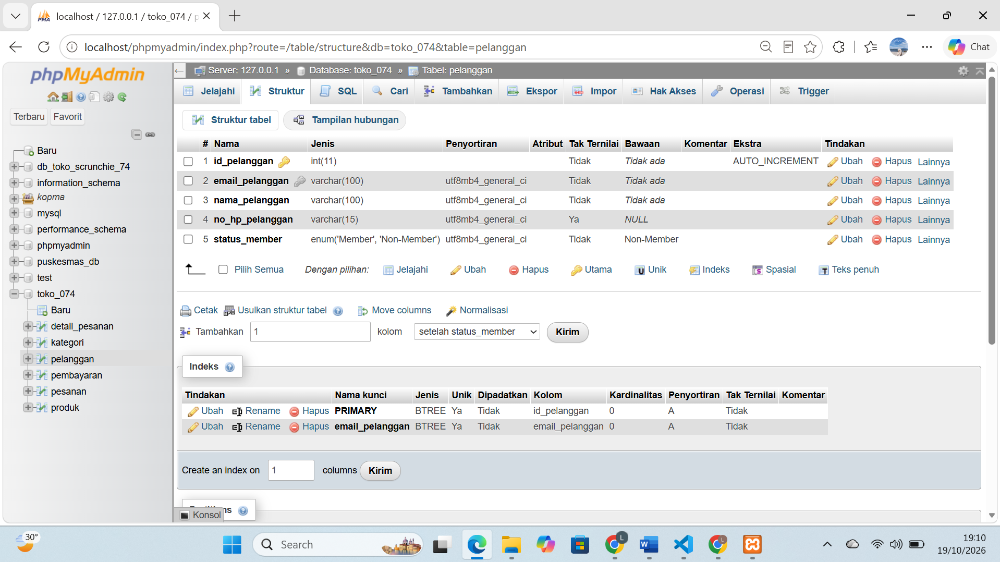
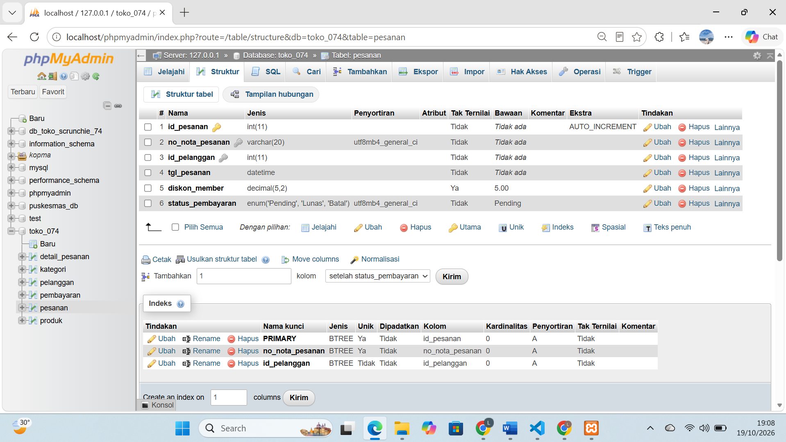
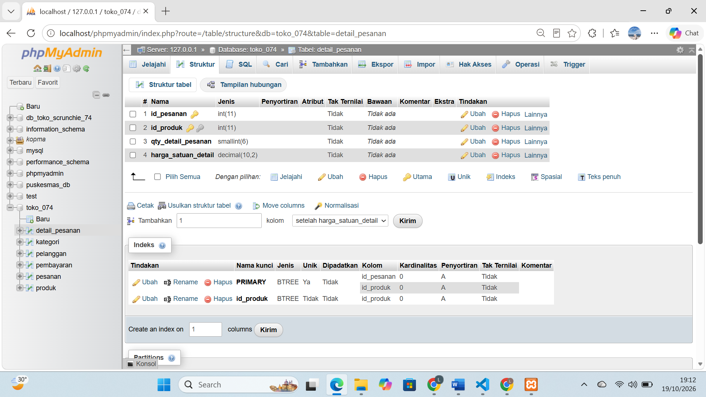
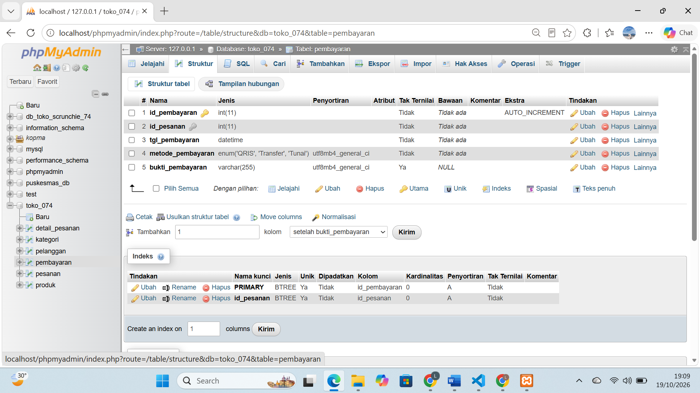
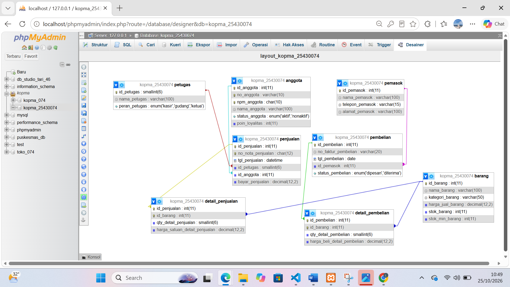

# LAPORAN PRAKTIKUM MODUL 5

## Identitas Mahasiswa

Nama: Laelin Hidayaturrohma
NPM: 25430074
Kelas: C
Mata Kuliah: Basis Data
Dosen Pengampu: Dedi Irawan, S.Kom, M.T.I
Program Studi: Ilmu Komputer
Fakultas: Ilmu Komputer
Instansi: Universitas Muhammadiyah Metro

## 1. Tujuan Praktikum

1. Menerjemahkan skema relasional 3NF menjadi perintah 'CREATE TABLE' dengan tipe data dan presisi yang tepat.
2. Menerapkan *constraint* ('PRIMARY KEY', 'FOREIGN KEY', 'UNIQUE', 'NOT NULL', 'DEFAULT', 'CHECK') sesuai aturan bisnis organisasi.
3. Mengubah dan menghapus struktur tabel dengan 'ALTER TABLE' dan 'DROP TABLE' dalam urutan dependensi yang benar.
4. Membuktikan bahwa *constraint* menolak data yang melanggar aturan bisnis, lalu membandingkan desain fisik di phpMyAdmin Designer dengan ERD.
5. Menyurun skrip DDL lengkap untuk proyek mandiri 'toko_074' ("Laelin Scrunchie & Hair Accessories") dan mengunggahnya ke repositori Git.

## 2. Alat dan Bahan
1. PC/Laptop dengan Windows 10/11 64-bit.
2. XAMPP 8.2.12 (MariaDB 10.4.32 dan phpMyAdmin 5.2.1).
3. Akun 'mhs_074' pada basis data 'kopma_25430074' dan  akun 'dev_074' pada basis data 'toko_074'.
4. Git for Windows dan repositori GitHub 'basisdata_25430074'.
5. Visual Studio Code atau editor teks untuk berkas '.sql' dan laporan '.md'.

## 3. Dasar Teori

*Data Definition Language* (DDL) adalah kumpulan perintah SQL yang mendefinisikan dan mengubah struktur skema basis data. Tipe data menentukan ketepatan hasil. Nilai uang memakai 'DECIMAL(p,s)', karena 'FLOAT' dan 'DOUBLE' menimbulkan galat pembulatan (floating-point rounding error).

*Constraint* memindahkan aturan bisnis dari aplikasi ke server basis data. Jenisnya: 
* 'PRIMARY KEY': menjamin baris unik dan menjadi identitas utama tabel. Kolomnya otomatis "NOT NULL' dan unik.
* 'FOREIGN KEY': menjaga integritas referensial antara tabel induk dan tabel anak. Aksi cascading seperti 'ON DELETE CASCADE' atau 'ON UPDATE CASCADE' bisa ditambahkan.
* 'UNIQUE': mencegah nilai ganda pada kolom tertentu, misalnya NIK, email, atau kode barang.
* 'CHECK': memeriksa apakah nilai kolom memenuhi ekspresi logika, misalnya $stok \ge 0$. MariaDB menjalankan 'CHECK' penuh sejak versi 10.
* 'NOT NULL': melarang kolom kosong atau mengisi nilai awal bila data tidak diberikan.

Urutan dependensi kunci tamu menentukan eksekusi DDL. Tabel induk dibuat lebih dulu daripada tabel anak. 'DROP' berjalan terbalik, dari tabel anak ke tabel induk, supaya tidak muncul galat.

## 4. Hasil Langkah Percobaan

### A. Pengujian Constraint (Error Handling)

1. Pelanggaran Foreign Key (ERROR 1452):
Saya memasukkan data penjualan dengan 'id_petugas' yang tidak ada di tabel induk 'petugas'.

Hasilnya: MariaDB menggagalkan perintah dengan 'ERROR 1452 (23000): Cannot add or update a chlid row: a foreign key constraint fails'.

2. Pelanggaran CHECK (ERROR 4025):
Saya memasukkan stok barang bernilai negatif ('stok = -5').

Hasilnya: MariaDB menggagalkan perintah dengan 'ERROR 4025 (23000): CONSTRAINT 'chk_produk_stok' failed for 'toko_074'.'produk''.

3. Pelanggaran UNIQUE (ERROR 1062)
Saya memasukkan dua baris pelanggan dengan email yang sama.

Hasilnya: MariaDB menolak dengan 'ERROR 162 (23000): Duplicate entry '...' for key 'email''.

### B. Struktur Tabel Proyek 'toko_074' ("Laelin Scrunchie & Hair Accessories")

1. Tabel 'kategori':

2. Tabel 'produk':

3. Tabel 'pelanggan':

4. Tabel 'pesanan':

5. Tabel 'detail_pesanan':

6. Tabel 'pembayaran':

### C. Relasi Fisik (phpMyAdmin Designer)

1. Skema relasi basis data Koperasi 'kopma_074':

2. Skema relasi basis data proyek 'toko_074':

## 5. Jawaban Titik Analisis

1. Titik Analisis 1: 'DECIMAL' vs 'FLOAT'/'DOUBLE' untuk nilai uang Analisis: 'FLOAT' dan 'DOUBLE' menyimpan angka dalam format biner IEEE 754 yang hanya mendekati nilai asli. Operasi hitung menghasilkan galat pembulatan ($0.1 + 0.2 \neq 0.3$). 'DECIMAL(12,2)' menyimpan angka eksak dengan presisi tetap, sehingga total transaksi tidak selisih satu sen atau satu rupiah pun.

2. Titik Analisis 2: 'CASCADE' vs 'RESTRICT' 
Analisis: 'ON DELETE CASCADE' membersihkan data anak otomatis, tetapi satu penghapusan tabel induk yang keliru ikut menghapus riwayat transaksi. Untuk data keuangan, saya memilih 'ON DELETE RESTRICT' atau 'NO ACTION': server menolak penghapusan induk selama masih ada transaksi anak yang merujuknya.

3. Titik Analisis 3: Urutan pembuatan dan penghapusan tabel
Analisis: Tabel induk tidak punya kunci tamu, jadi saya membuatnya lebih dulu. Bila tabel anak dibuat lebih dulu, MariaDB menampilkan galat karena tabel acuan 'FOREIGN KEY' belum ada. 'DROP TABLE' berjalan sebaliknya: tabel anak dihapus dulu, lalu tabel induk. Urutan lain membuat perintah gagal karena *foreign key constraint*.

4. Titik Analisis 4: Penegakan 'CHECK' di MariaDB
Analisis: MariaDB sebelum 10.2 dan MySQL sebelum 8.0.16 hanya membaca sintaks 'CHECK' lalu mengabaikannya. MariaDB 10.4.32 yang saya pakai menjalankan 'CHECK' penuh. Query yang melanggar ekspresi boolean 'CHECK' berhenti dengan 'ERROR 4025'.

## 6. Hasil Latihan dan Modifikasi

1. Menambah batasan *default* dan *check* pada 'kopma_074':
  * Saya menambahkan 'DEFAULT CURRENT_TIMESTAMP' pada kolom 'tgl_penjualan'.
  * Saya menambahkan *costraint check* 'chk_harga' supaya 'harga_jual > 0'.

2. Mengubah skema dengan 'ALTER TABLE':
  * Saya menambah kolom 'email' pada tabel 'anggota' lalu memberinya batasan 'UNIQUE'.

## 7. Tugas Mandiri: Milestone Proyek 5

Skrip DLL proyek mandiri 'toko_074' ("Laelin Scrunchie & Hair Accessories") tersimpan di dua berkas pada *root* repositori:

* **'p05_ddl_25430074.sql'**: membuat 6 tabel proyek ('kategori', 'pelanggan', 'produk', 'pesanan', 'detail_pesanan', 'pemebayaran') beserta semua *constraint* ('PRIMARY KEY', 'UNIQUE', 'NOT NULL', 'DEFAULT', 'CHECK').
* **'p05_ddl_kopma_25430074.sql'**: membuat struktur tabel basis data studi kasus Kopma Sejahtera.

Aturan bisnis dan *constraint* dalam skrip:

1. **Keunikan (*Unique Constraint*): ** 'nama_kategori', 'kode_produk', 'email', 'pelanggan', 'kode_pesanan', dan 'id_pesanan' di tabel pembayaran bersifat 'UNIQUE' agar data tidak ganda.
2. **Harga dan stok (Check Constraint*):** 'CHECK (harga > 0)' dan 'CHECK (stok >= 0)' pada 'produk', serta 'CHECK (jumlah > 0)' pada 'detail_pesanan'.
3. **Integritas referensial (*Foreign Key*):** 'produk' merujuk 'kategori', 'pesanan' merujuk 'pelanggan', 'detail_pesanan' merujuk 'pesanan' dan 'produk', 'pembayaran' merujuk 'pesanan'. Semuanya memakai 'ON UPDATE CASCADE' dan 'ON DELETE RESTRICT' atau 'CASCADE'.

## 8. Kesimpulan

Saya merancang basis data fisik dengan DDL di MariaDB dan menyelesaikan semua tujuan praktikum. Skema relasional hasil normalisasi menjadi perintah 'CREATE TABLE', dengan 'DECIMAL(12,2)' untuk nilai uang agar perhitungan keuangan tidak bergalat. Semua *constraint* ('PRIMARY KEY', 'FOREIGN KEY', 'UNIQUE', 'NOT NULL', 'DEFAULT', 'CHECK') menolak data cacat, terbukti lewat ERROR 1452, 4025, dan 1062. Skrip DDL proyek "Laelin Scrunchie & Hair Accessories" ('toko_074') berjalan tanpa galat, dan relasinya tampil sesuai rancangan di phpMyAdmin Designer.

## 9. Pernyataan Penggunaan AI

Asisten AI membantu saya memeriksa sintaks DDL SQL, menyusun ekspresi *constraint check*, dan memastikan urutan dependensi *foreign key* tidak bentrok.

## 10. Bukti Git

Tautan Repositori: 'https://github.com/laelinhdytrhma18-cell/basisdata_25430074'

Hash commit Modul 5:
- Upload p05_ddl_25430074.sql, p05_ddl_kopma_25430074.sql, dan pembaruan README.md: 'ed0efa6'
- Upload p05_laporan_25430074.md: '5686fa9'

## Checklist Verifikasi Mandiri Modul 5
 
- [x] Skrip `p05_ddl_kopma_25430074.sql` dan `p05_ddl_25430074.sql` tersimpan di *root* repositori.
- [x] Tangkapan layar galat FK, CHECK, UNIQUE dan struktur tabel `toko_074` tersimpan di folder `laporan/img/`.
- [x] Semua *constraint* (`PRIMARY KEY`, `FOREIGN KEY`, `UNIQUE`, `NOT NULL`, `CHECK`, `DEFAULT`) sudah diterapkan sesuai kebutuhan bisnis.
- [x] Jawaban Titik Analisis 1 sampai 4 terisi lengkap.
- [x] Skema relasi fisik phpMyAdmin Designer untuk `kopma_074` dan `toko_074` terdokumentasi.
- [x] Tautan repositori GitHub dan hash commit tercantum.
