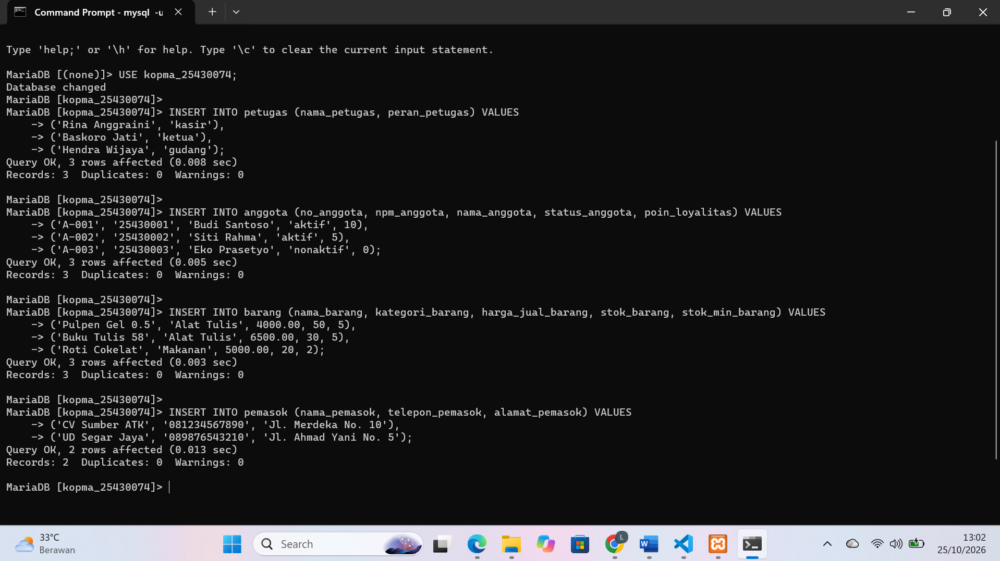
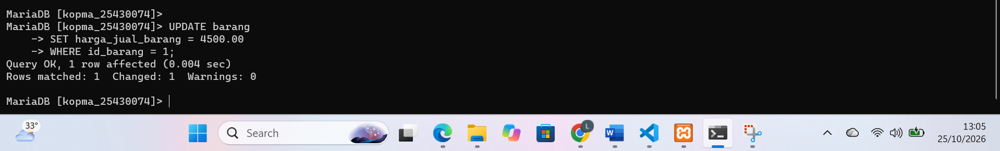
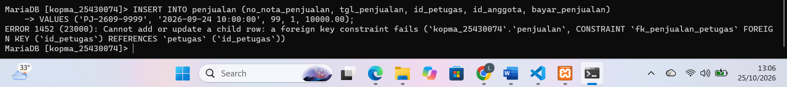
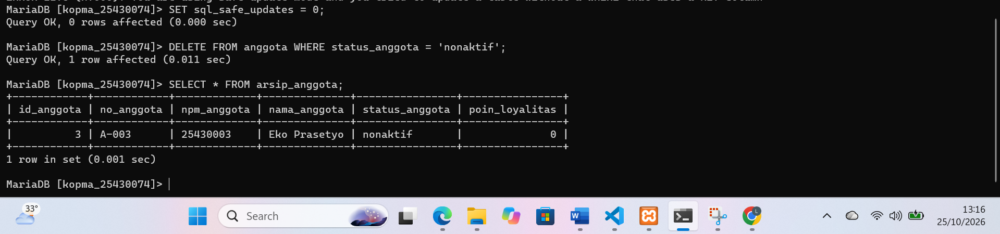
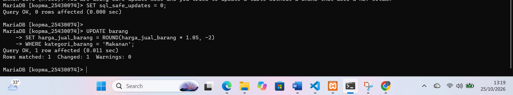
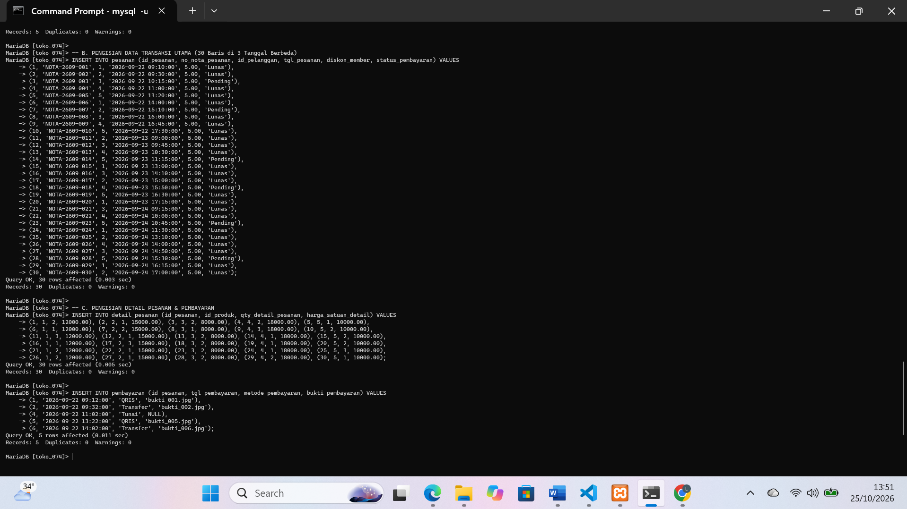
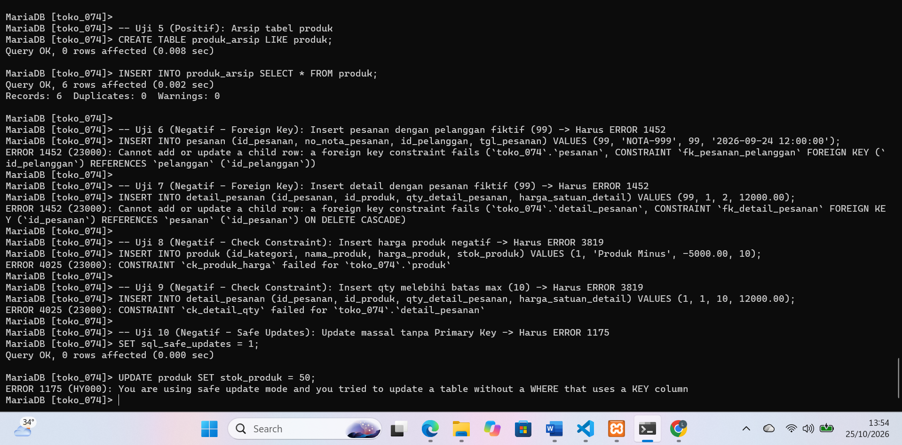

# LAPORAN PRAKTIKUM MODUL 6

## Identitas Mahasiswa

Nama: Laelin Hidayaturrohma  
NPM: 25430074  
Kelas: C  
Mata Kuliah: Basis Data  
Dosen Pengampu: Dedi Irawan, S.Kom, M.T.I  
Program Studi: Ilmu Komputer  
Fakultas: Ilmu Komputer  
Instansi: Universitas Muhammadiyah Metro  

---

## 1. Tujuan Praktikum

1. Menambah data dengan `INSERT` satu baris, banyak baris, dan `INSERT ... SELECT`.
2. Mengubah dan menghapus data dengan `UPDATE` dan `DELETE` secara aman memakai mode `sql_safe_updates`.
3. Menyusun skenario uji positif dan negatif serta mencatat hasilnya.
4. Menyiapkan data sampel proyek yang dapat dibangun ulang dari skrip.

---

## 2. Alat dan Bahan

1. PC/Laptop dengan Windows 10/11 64-bit.
2. XAMPP 8.2.12 (MariaDB 10.4.32 dan phpMyAdmin 5.2.1).
3. Akun `mhs_074` pada basis data `kopma_25430074` dan akun `dev_074` pada basis data `toko_074`.
4. Git for Windows dan repositori GitHub `basisdata_25430074`.
5. Visual Studio Code atau editor teks untuk berkas `.sql` dan laporan `.md`.

---

## 3. Dasar Teori

*Data Manipulation Language* (DML) terdiri atas perintah `INSERT`, `UPDATE`, `DELETE`, dan `SELECT`. Karena terdapat hubungan kunci tamu (*foreign key*), urutan pengisian data harus mengikuti urutan pembuatan tabel: data induk (master) dimasukkan terlebih dahulu, diikuti oleh data anak (transaksi). Urutan penghapusan berjalan sebaliknya, kecuali jika digunakan relasi dengan klausa `ON DELETE CASCADE`.

Pengubahan atau penghapusan data tanpa klausa `WHERE` pada perintah `UPDATE` atau `DELETE` dapat memengaruhi seluruh baris di dalam tabel. Untuk mengantisipasi kesalahan ini, variabel `sql_safe_updates` diaktifkan agar server menolak perintah pengubahan atau penghapusan yang tidak menggunakan kolom kunci utama (*Primary Key*) atau batasan `LIMIT`.

Pengujian basis data dilakukan dengan menguji skenario positif (data valid harus diterima) dan skenario negatif (data salah harus ditolak dengan pesan galat yang tepat). Setiap skenario dicatat secara sistematis untuk menjamin integritas dan keandalan data.

---

## 4. Hasil Langkah Percobaan

### A. Pengisian Data Induk dan Transaksi Nota (Kopma Sejahtera)

1. **Pengisian Data Induk dan Nota Penjualan:**  
   Data induk divalidasi dan diisikan ke tabel `petugas`, `barang`, `anggota`, dan `pemasok`. Pencatatan detail transaksi menggunakan `INSERT ... SELECT` untuk menyalin harga barang secara langsung dari tabel master.  
     
   *Hasil:* Seluruh query `INSERT` masal dan `INSERT ... SELECT` berhasil dieksekusi tanpa galat.

### B. Pengujian Mode Aman dan Error Handling (Kopma Sejahtera)

1. **Pelanggaran Safe Update Mode (ERROR 1175):**  
   Mencoba melakukan pembaruan masal pada harga barang tanpa klausa `WHERE` yang melibatkan kolom kunci saat mode aman aktif (`SET SESSION sql_safe_updates = 1;`).  
     
   *Hasil:* MariaDB menggagalkan perintah dengan pesan `ERROR 1175 (HY000): You are using safe update mode and you tried to update a table without a WHERE that uses a KEY column`.

2. **Pelanggaran Foreign Key Constraint (ERROR 1452):**  
   Mencoba menghapus petugas yang pernah melayani transaksi penjualan atau menginput nota dengan ID acuan yang tidak ada di tabel induk.  
     
   *Hasil:* MariaDB menolak dengan pesan `ERROR 1452 (23000): Cannot add or update a child row: a foreign key constraint fails`.

---

## 5. Jawaban Titik Analisis

1. **Titik Analisis 1 (INSERT ... SELECT vs Manual):**  
   * *Analisis:* Perintah `INSERT ... SELECT` jauh lebih aman daripada mengetik angka manual karena harga langsung disalin otomatis dari tabel `produk` secara presisi, menghindari *human error*. Ketika harga produk naik di masa depan, nota transaksi lama **tidak ikut berubah** karena nilai harga yang disalin tersimpan sebagai riwayat (*historical snapshot*) pada kolom `harga_satuan_detail` di tabel `detail_pesanan` saat transaksi dicatat.

2. **Titik Analisis 2 (ON DELETE CASCADE vs RESTRICT):**  
   * *Analisis:* Menghapus nota pesanan otomatis menghapus detail rincian barangnya karena tabel `detail_pesanan` menggunakan `ON DELETE CASCADE` terhadap tabel `pesanan`. Sebaliknya, menghapus data induk pelanggan yang memiliki riwayat transaksi ditolak (`ERROR 1452`) karena relasinya menggunakan `ON DELETE RESTRICT` untuk mengamankan data historis. Jika seorang pelanggan tidak aktif lagi, statusnya diperbarui, bukan menghapus baris datanya dari basis data.

3. **Titik Analisis 3 (Skenario Uji Gagal dan Limitasi Constraint):**  
   * *Analisis:* Pengujian ke-10 (Utang Desain) memperlihatkan bahwa validasi ketersediaan stok produk saat transaksi penjualan tidak dapat diselesaikan hanya dengan *constraint* tabel statis. Constraint `CHECK` hanya mengevaluasi kondisi pada satu baris tabel lokal saat pengubahan/penambahan, tidak bisa melakukan kueri silang (*cross-table validation*) ke tabel `detail_pesanan`. Validasi ini dicatat sebagai **Utang Desain untuk Modul 14** (yang nantinya akan diselesaikan dengan kontrol transaksi dinamis/Trigger).

---

## 6. Hasil Latihan dan Modifikasi

1. **Latihan E.1 (Pengarsipan Anggota Nonaktif):**  
   Memindahkan anggota berstatus `nonaktif` yang mendaftar sebelum tahun 2025 ke tabel `anggota_arsip` menggunakan `CREATE TABLE ... LIKE` dan `INSERT ... SELECT`, kemudian menghapusnya dari tabel asal.  
   

2. **Latihan E.2 (Pembaruan Harga Makanan 5% Dibulatkan):**  
   Menuliskan perintah `UPDATE` untuk menaikkan harga semua barang kategori `makanan` sebesar 5% dan membulatkannya ke ratusan terdekat.  
   

---

## 7. Tugas Mandiri: Milestone Proyek 6

Pengisian data sampel proyek mandiri **`toko_074` ("Laelin Scrunchie & Hair Accessories")** dilakukan melalui berkas `p06_data_25430074.sql` dengan ketentuan:
* Tabel induk minimal 5 baris data.
* Tabel transaksi utama (`pesanan`) berisi **30 baris** ($10 \times P$ dengan $P=3$) yang tersebar pada minimal 3 tanggal berbeda.

### A. Tangkapan Layar Pengisian Data Proyek (`toko_074`)

### B. Tangkapan Layar Pengujian Skenario Proyek (`toko_074`)

### C. Ringkasan Pengujian Skenario DML (`toko_074`)

Rincian lengkap matriks skenario pengujian DML beserta perintah SQL dan pesan galat MariaDB terdokumentasi secara terpisah pada berkas **`p06_uji_25430074.md`**. Secara ringkas, hasil pengujian 10 skenario DML pada basis data `toko_074` menunjukkan:

* **Skenario Positif (UJ-01, UJ-02, UJ-08):** Penambahan data pelanggan/pesanan valid serta mekanisme penhapusan otomatis bertingkat (*CASCADE*) pada tabel rincian pesanan berhasil dieksekusi dengan status `Query OK`.
* **Skenario Negatif (UJ-03 s.d. UJ-07, UJ-09):** Seluruh batasan integritas basis data terbukti efektif menolak manipulasi data yang salah, meliputi:
  * Penolakan harga negatif (`ck_produk_harga`) dan kuantitas melampaui batas (`ck_detail_qty`) dengan galat `ERROR 4025`.
  * Penolakan duplikasi nomor nota (`uq_pesanan_nota`) dan duplikasi email pelanggan (`uq_pelanggan_email`) dengan galat `ERROR 1062`.
  * Penolakan referensi kunci asing fiktif (`fk_pesanan_pelanggan`) dengan galat `ERROR 1452`.
  * Penolakan pembaruan data tanpa klausa `WHERE` saat mode aman aktif dengan galat `ERROR 1175`.
* **Utang Desain (UJ-10):** Pengujian perbandingan stok produk secara dinamis lintas tabel saat transaksi belum dapat ditangani oleh *constraint* statis MariaDB dan dicatat sebagai utang desain untuk diselesaikan pada Modul 14.

---

## 8. Kesimpulan

Praktikum Modul 6 berhasil dilaksanakan dengan baik. Pemahaman mengenai perintah DML (`INSERT`, `UPDATE`, `DELETE`, `SELECT`) diterapkan secara nyata pada kasus Kopma Sejahtera dan proyek mandiri "Laelin Scrunchie & Hair Accessories" (`toko_074`). Penggunaan `sql_safe_updates` efektif mencegah ketidaksengajaan manipulasi data masal, sedangkan aturan integritas referensial dan *Check Constraint* terbukti mampu menolak input data yang tidak valid. Hasil eksekusi 10 skenario pengujian yang tercatat pada berkas `p06_uji_25430074.md` mengonfirmasi keandalan basis data serta mengidentifikasi batasan *CHECK constraint* yang dikategorikan sebagai utang desain untuk Modul 14.

---

## 9. Pernyataan Penggunaan AI

Asisten AI digunakan untuk membantu memverifikasi sintaks kueri DML, mengonstruksi skenario uji coba positif dan negatif, menganalisis pesan galat MariaDB, serta menyusun struktur dokumentasi laporan dalam format Markdown.

---

## 10. Bukti Git

* **Tautan Repositori:** `https://github.com/laelinhdytrhma18-cell/basisdata_25430074`
* **Hash Commit Modul 6:**
  * Upload `p06_data_25430074.sql`, `p06_data_kopma_25430074.sql`, dan `p06_uji_25430074.md`: `1dd875d`
  * Upload `p06_laporan_25430074.md` dan bukti gambar: `6299cbb`

---

## Checklist Verifikasi Mandiri Modul 6

[x] Skrip `p06_data_25430074.sql` dan `p06_uji_25430074.md` tersimpan di *root* repositori.
[x] Tangkapan layar hasil pengisian data, error handling, dan pengujian tersimpan di folder `laporan/img/`.
[x] Data sampel proyek `toko_074` memenuhi kuota minimal 30 baris transaksi pada 3 tanggal berbeda ($10 \times P$).
[x] Jawaban Titik Analisis 1, 2, dan 3 terisi lengkap beserta identifikasi utang desain.
[x] Latihan pengarsipan data dan update harga berhasil dijalankan dan didokumentasikan.
[x] Tautan repositori GitHub dan hash commit tercantum.