# LAPORAN PRAKTIKUM MODUL 7

## Identitas Mahasiswa

Nama: Laelin Hidayaturrohma  
NPM: 25430074  
Kelas: C  
Mata Kuliah: Basis Data  
Dosen Pengampu: Dedi Irawan, S.Kom, M.T.I  
Program Studi: Ilmu Komputer  
Fakultas: Ilmu Komputer  
Instansi: Universitas Muhammadiyah Metro  

---

## 1. Tujuan Praktikum

1. Menerapkan klausa `SELECT` dengan penyaringan data menggunakan operator pencarian pola (`LIKE`), rentang (`BETWEEN`), himpunan (`IN`), dan nilai kosong (`IS NULL`).
2. Menggunakan fungsi skalar string (`UPPER`, `CONCAT`), fungsi tanggal (`DATE_FORMAT`), dan pemformatan angka lokal (`FORMAT` dengan `id_ID`).
3. Mengimplementasikan logika kondisional pada kueri `SELECT` menggunakan ekspresi `CASE WHEN` dan penanganan nilai kosong (`IFNULL`).
4. Memahami urutan eksekusi kueri SQL (*Query Processing Order*) dan pengaruh penggunaan tanda kurung pada ekspresi logika gabungan (`AND`/`OR`).
5. Menyusun minimal 10 kueri `SELECT` satu tabel yang terstruktur dan terdokumentasi lengkap untuk menjawab Kebutuhan Informasi (KI) proyek mandiri (`toko_074`).

---

## 2. Alat dan Bahan

1. PC/Laptop dengan Windows 10/11 64-bit.
2. XAMPP 8.2.12 (MariaDB 10.4.32 dan phpMyAdmin 5.2.1).
3. Basis data `kopma_25430074` dan basis data proyek mandiri `toko_074`.
4. Git for Windows dan repositori GitHub `basisdata_25430074`.
5. Visual Studio Code atau editor teks untuk berkas `.sql` dan laporan `.md`.

---

## 3. Dasar Teori

Klausa `SELECT` merupakan perintah dasar pada Data Query Language (DQL) yang digunakan untuk mengambil dan memanipulasi tampilan data dari tabel basis data. Penyaringan baris dilakukan melalui klausa `WHERE` yang mendukung berbagai operator relasional dan logika, seperti `BETWEEN` untuk menentukan rentang nilai, `LIKE` dengan karakter liar (*wildcard* `%` dan `_`) untuk pencarian pola teks, `IN` untuk pencocokan nilai dalam himpunan, serta `IS NULL` untuk mengevaluasi keberadaan nilai yang tidak terdefinisi.

Fungsi skalar memproses satu nilai masukan dan mengembalikan satu nilai keluaran. Fungsi string (seperti `UPPER` dan `CONCAT`) serta fungsi tanggal (seperti `DATE_FORMAT`) digunakan untuk mengubah format data agar lebih informatif bagi pengguna. Pemformatan angka menggunakan `FORMAT(angka, desimal, 'id_ID')` memungkinkan penyajian angka sesuai standar mata uang Indonesia.

Penggunaan logika kondisional seperti `CASE WHEN` dan `IFNULL` memungkinkan pembuatan kolom virtual berbasis aturan bisnis langsung di tingkat database server. Dalam eksekusi kueri, klausa diproses berdasarkan *Query Processing Order* (dimulai dari `FROM`, `WHERE`, `GROUP BY`, `HAVING`, `SELECT`, hingga `ORDER BY`), sehingga alias kolom yang didefinisikan pada klausa `SELECT` tidak dapat digunakan secara langsung dalam klausa `WHERE`.

---

## 4. Hasil Langkah Percobaan

### A. Proyeksi Dasar, Alias, dan Sorting (Kopma Sejahtera)

1. **Proyeksi Kolom dengan Alias dan Pengurutan (`ORDER BY`):**  
   Mengambil kolom `nama_barang`, `harga_jual_barang`, dan `stok_barang` dengan alias yang disesuaikan serta memfilter barang berharga di atas 5000 terurut ascending.  
   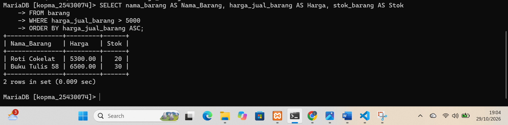  
   *Hasil:* Menampilkan data `Roti Cokelat` dan `Buku Tulis 58` terurut berdasarkan harga jual.

### B. Pencarian Pola Teks dan Fungsi String (Kopma Sejahtera)

1. **Pencarian Pola (`LIKE`) dan Konversi Kapital (`UPPER`):**  
   Mencari nama barang yang mengandung frasa 'Roti' dan menampilkan nama barang dalam bentuk huruf kapital.  
   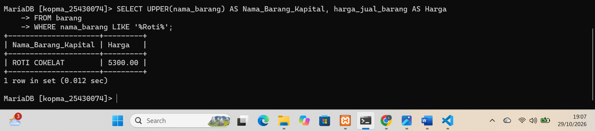  
   *Hasil:* Berhasil menyaring dan mengubah tampilan `Roti Cokelat` menjadi `ROTI COKELAT`.

2. **Penggabungan Teks (`CONCAT`):**  
   Menggabungkan informasi nama barang dan stok ke dalam satu kolom teks terintegrasi.  
   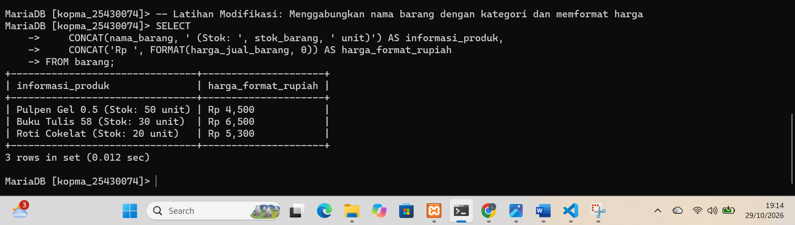  
   *Hasil:* Menampilkan penggabungan string deskriptif barang beserta jumlah stoknya.

### C. Filtering Rentang Nilai (Kopma Sejahtera)

1. **Penyaringan Rentang Harga (`BETWEEN`):**  
   Mengambil data barang yang memiliki harga jual di rentang 5000 hingga 10000.  
   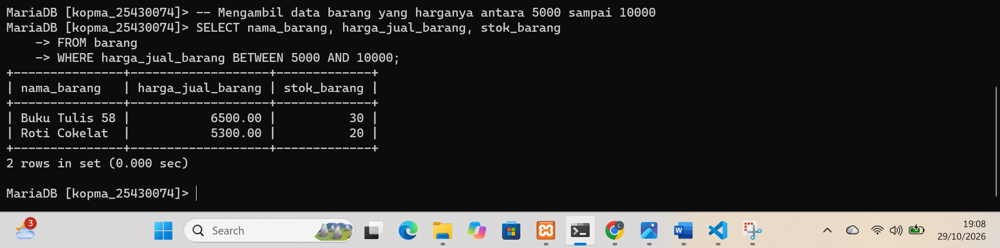  
   *Hasil:* Menampilkan baris data `Buku Tulis 58` dan `Roti Cokelat`.

### D. Logika Kondisional dalam Kueri (Kopma Sejahtera)

1. **Kategorisasi Status Stok (`CASE WHEN`):**  
   Mengelompokkan stok barang menjadi dua kategori status secara otomatis berdasarkan ambang batas stok.  
   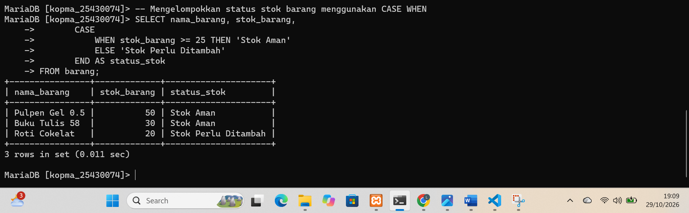  
   *Hasil:* Kolom virtual `status_stok` menampilkan 'Stok Aman' untuk stok $\ge 25$ dan 'Stok Perlu Ditambah' untuk sisanya.

2. **Rekapitulasi Kueri Percobaan Kopma:**  
   Eksekusi keseluruhan berkas skrip kueri percobaan pada basis data Kopma Sejahtera.  
   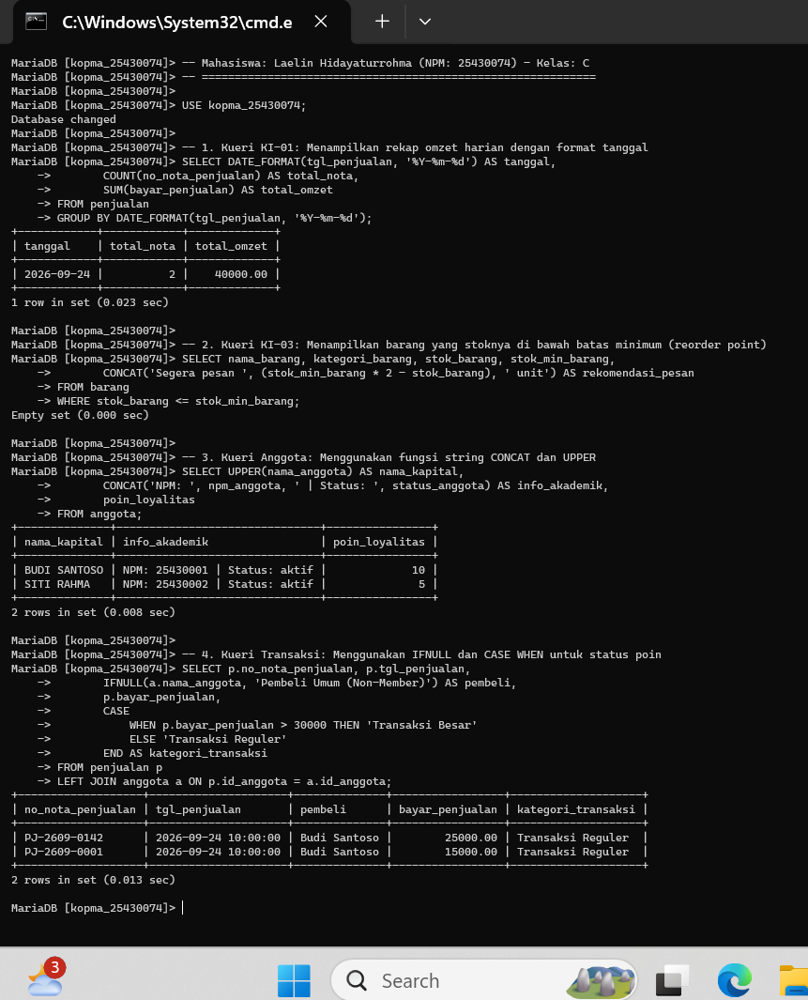  
   *Hasil:* Seluruh kueri percobaan 1 hingga 4 pada basis data `kopma_25430074` berhasil dieksekusi tanpa galat.

---

## 5. Jawaban Titik Analisis

1. **Titik Analisis 1 (Alias Kolom pada Klausa WHERE):**  
   * *Analisis:* Alias kolom yang didefinisikan pada klausa `SELECT` (misalnya `SELECT harga_jual_barang AS Harga`) **tidak dapat** langsung digunakan di dalam klausa `WHERE`. Hal ini disebabkan oleh *Query Processing Order* pada MariaDB/MySQL, di mana klausa `WHERE` dieksekusi terlebih dahulu sebelum tahap `SELECT`. Pada saat `WHERE` memfilter baris data, alias `Harga` belum dibentuk oleh sistem.  
   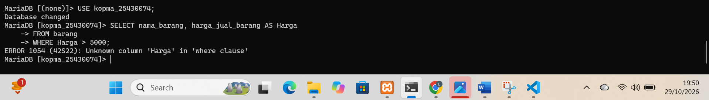  
   *Hasil Pengujian:* MariaDB menolak kueri dengan pesan `ERROR 1054 (42S22): Unknown column 'Harga' in 'where clause'`.

2. **Titik Analisis 2 (Perbandingan Nilai NULL):**  
   * *Analisis:* Nilai `NULL` merepresentasikan kondisi *unknown* atau ketiadaan data. Oleh karena itu, penggunaan operator sama dengan (`= NULL`) akan menghasilkan evaluasi `UNKNOWN` (dianggap *FALSE*), sehingga kueri menghasilkan `Empty set`. Untuk mengevaluasi atau memfilter data bernilai kosong secara benar, harus menggunakan operator khusus `IS NULL` atau `IS NOT NULL`.  
   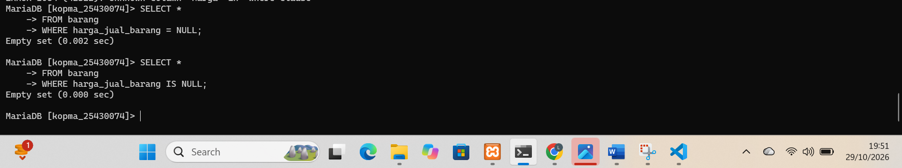  
   *Hasil Pengujian:* Perbandingan `= NULL` menghasilkan `Empty set (0.002 sec)`, membuktikan bahwa operator relasional `=` tidak dapat mengevaluasi nilai `NULL`.

3. **Titik Analisis 3 (Pentingnya Fungsi Skalar):**  
   * *Analisis:* Fungsi skalar (`UPPER`, `DATE_FORMAT`, `CONCAT`, `FORMAT`) sangat penting dalam pengolahan basis data karena memungkinkan manipulasi dan perapihan tampilan data (*data presentation layer*) langsung di tingkat server database tanpa mengubah data mentah fisik yang tersimpan pada tabel. Hal ini meningkatkan efisiensi pemrosesan dan konsistensi penyajian informasi kepada pengguna akhir.

---

## 6. Hasil Latihan dan Modifikasi

1. **Latihan E.1 (Huruf Kapital dan Format Rupiah `id_ID`):**  
   Menampilkan nama barang dalam huruf kapital penuh dan memformat harga jual ke dalam format mata uang Rupiah menggunakan pemisah ribuan lokal `id_ID`.  
   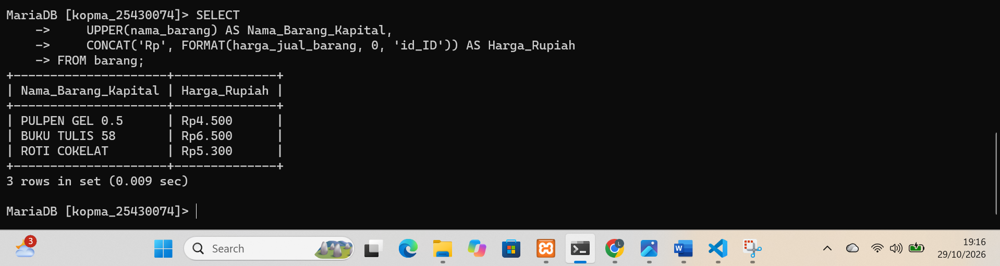  
   *Hasil:* Tampilan harga berubah menjadi format Rupiah Indonesia yang rapi (`Rp4.500`, `Rp6.500`, `Rp5.300`).

2. **Latihan E.2 (Koreksi Logika Semantik `OR` dan `AND`):**  
   Menunjukkan dampak perbedaan prioritas operator logika tanpa dan dengan tanda kurung.  
   * **Kueri Salah Secara Semantik (Tanpa Tanda Kurung):**  
     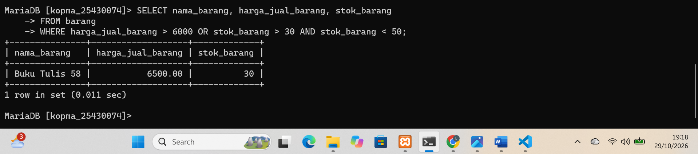  
   * **Kueri Perbaikan (Menggunakan Tanda Kurung):**  
       
   * *Analisis:* Tanpa tanda kurung, operator `AND` dieksekusi lebih dahulu daripada `OR`. Penambahan tanda kurung `(...)` memastikan kelompok kondisi `OR` dievaluasi terlebih dahulu sebelum digabungkan dengan syarat `AND`.

---

## 7. Tugas Mandiri: Milestone Proyek 7

Penyusunan 10 kueri 1 tabel untuk mendukung Kebutuhan Informasi (KI) proyek mandiri **`toko_074` ("Laelin Scrunchie & Hair Accessories")** disimpan secara lengkap pada berkas **`p07_kueri_25430074.sql`**.

### A. Tangkapan Layar Eksekusi Kueri Proyek (`toko_074`)

1. **Eksekusi Kueri KI-01 (Filter Transaksi Lunas dan Rentang Tanggal BETWEEN):**  
   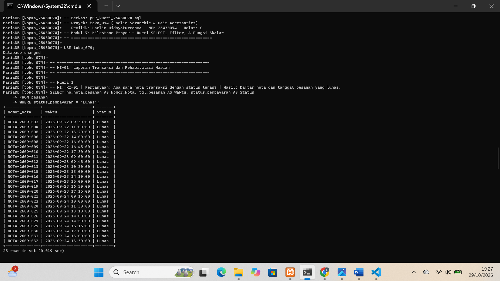

2. **Eksekusi Kueri KI-01 & KI-02 (Formatting Tanggal DATE_FORMAT dan Pencarian LIKE UPPER):**  
   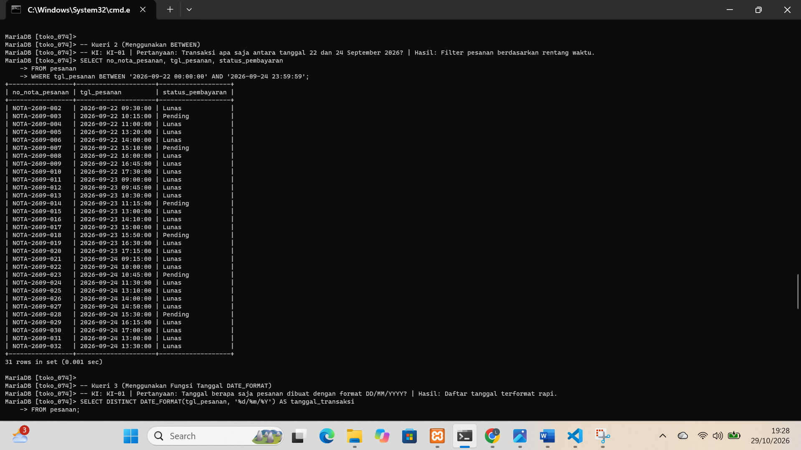

3. **Eksekusi Kueri KI-02 & KI-03 (Penyaringan Himpunan IN dan Filter Status Pelanggan):**  
   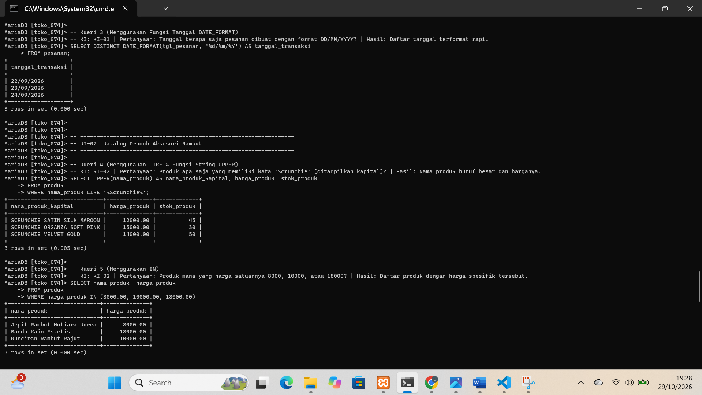

4. **Eksekusi Kueri KI-03 & KI-04 (Pengecekan IS NULL dan Evaluasi Stok CASE WHEN):**  
   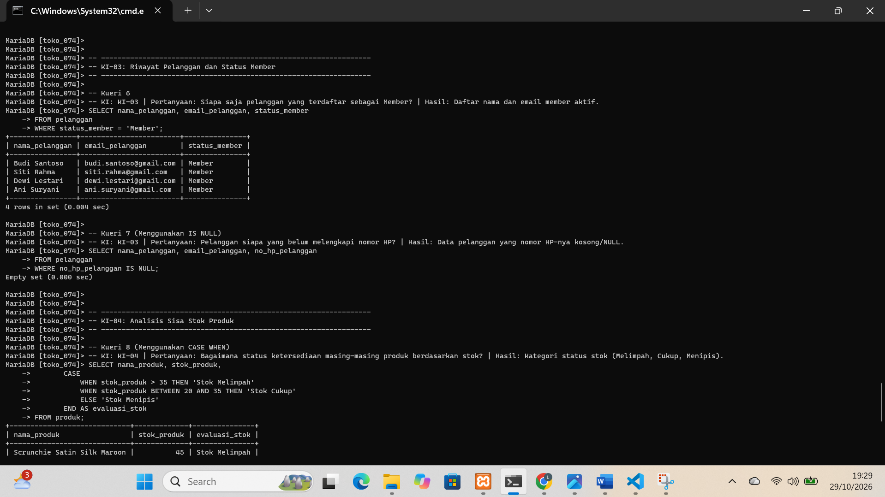

5. **Eksekusi Kueri KI-05 (Metode Pembayaran dan Penanganan Null IFNULL):**  
   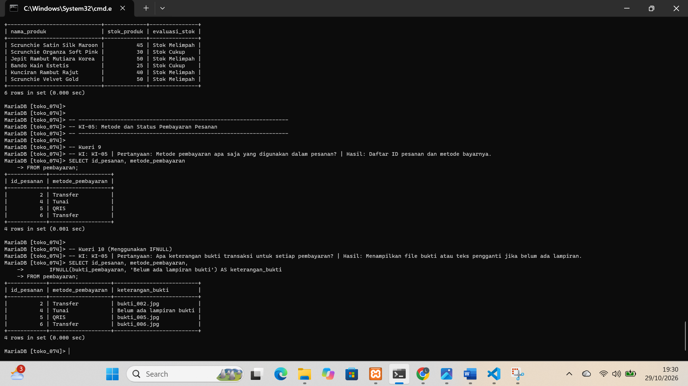

### B. Ringkasan Implementasi 10 Kueri Proyek (`toko_074`)

| No | Kode KI | Fungsi / Operator Utama | Deskripsi Pertanyaan Bisnis |
| :--- | :--- | :--- | :--- |
| 1 | KI-01 | Filter Dasar (`WHERE`) | Menampilkan daftar nota transaksi yang berstatus 'Lunas'. |
| 2 | KI-01 | `BETWEEN` | Memfilter transaksi pesanan dalam rentang tanggal 22–24 September 2026. |
| 3 | KI-01 | `DATE_FORMAT` | Menampilkan riwayat tanggal transaksi terformat rapi (`DD/MM/YYYY`). |
| 4 | KI-02 | `LIKE` & `UPPER` | Mencari produk kategori 'Scrunchie' dan menampilkan namanya dalam huruf kapital. |
| 5 | KI-02 | `IN` | Menyaring produk yang memiliki harga satuan spesifik (8000, 10000, 18000). |
| 6 | KI-03 | Filter Eksak | Menampilkan daftar nama dan email pelanggan yang berstatus 'Member'. |
| 7 | KI-03 | `IS NULL` | Mengidentifikasi data pelanggan yang belum mengisi nomor telepon (`no_hp_pelanggan`). |
| 8 | KI-04 | `CASE WHEN` | Mengategorikan stok produk menjadi 'Stok Melimpah', 'Stok Cukup', atau 'Stok Menipis'. |
| 9 | KI-05 | Proyeksi Kolom | Menampilkan daftar metode pembayaran yang digunakan oleh pelanggan. |
| 10 | KI-05 | `IFNULL` | Menampilkan nama file bukti pembayaran atau teks alternatif jika lampiran kosong. |

---

## 8. Kesimpulan

Praktikum Modul 7 berhasil dilaksanakan dengan baik. Pemahaman mengenai kueri `SELECT` lanjutan, penyaringan data tingkat lanjut, penggunaan fungsi skalar, serta penerapan logika kondisional telah berhasil diimplementasikan pada studi kasus Kopma Sejahtera dan proyek mandiri `toko_074`. Pemahaman mengenai *Query Processing Order* menjelaskan alasan alias kolom tidak dapat dipakai di klausa `WHERE`, sedangkan pentingnya penggunaan tanda kurung terbukti krusial dalam menjaga kebenaran logika semantik saat menggunakan kombinasi operator `AND` dan `OR`. Sebanyak 10 kueri terstruktur pada berkas `p07_kueri_25430074.sql` siap digunakan untuk mendukung kebutuhan pelaporan data pada proyek `toko_074`.

---

## 9. Pernyataan Penggunaan AI

Asisten AI digunakan untuk membantu memverifikasi sintaks kueri SQL lanjutan, menganalisis struktur logika ekspresi `CASE` dan fungsi skalar `FORMAT` lokal (`id_ID`), memvalidasi pemahaman urutan eksekusi kueri, serta menyusun dokumentasi laporan Markdown agar konsisten dengan format laporan praktikum sebelumnya.

---

## 10. Bukti Git

* **Tautan Repositori:** `https://github.com/laelinhdytrhma18-cell/basisdata_25430074`
* **Hash Commit Modul 7:**
  * Upload p07_kueri_25430074.sql dan bukti gambar: `479bbbe`
  * Upload p07_laporan_25430074.md: `c2fd07e`

---

## Checklist Verifikasi Mandiri Modul 7

 [x] Skrip `p07_kueri_25430074.sql` tersimpan di *root* repositori dan terhubung ke `toko_074`.
 [x] Tangkapan layar hasil langkah percobaan dan latihan tersimpan di folder `laporan/img/` dengan awalan `p07_`.
 [x] Berkas `p07_kueri_25430074.sql` berisi minimal 10 kueri satu tabel dilengkapi komentar Kode KI, Pertanyaan, dan Hasil Ekspektasi.
 [x] Kueri memenuhi syarat penggunaan `LIKE`, `BETWEEN`, `IN`, `IS NULL`, `CASE`, fungsi tanggal (`DATE_FORMAT`), dan fungsi string (`UPPER`).
 [x] Jawaban Titik Analisis 1, 2, dan 3 terisi lengkap.
 [x] Latihan format Rupiah `id_ID` dan perbaikan logika semantik dengan tanda kurung didokumentasikan.
 [x] Tautan repositori GitHub dan hash commit tercantum.