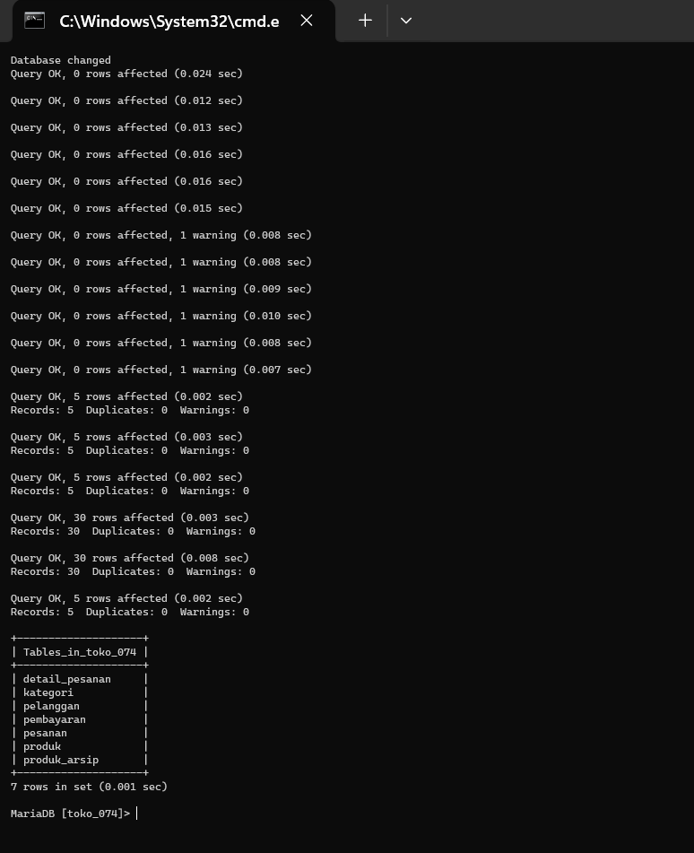
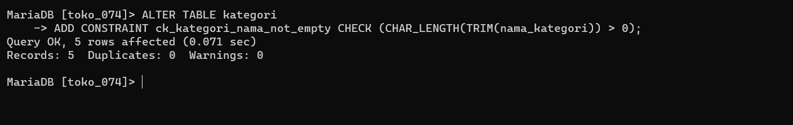

# Laporan Praktikum Pertemuan 8: UTS Proyek Tahap 1

**Identitas Mahasiswa:**
- **Nama:** Laelin Hidayaturrohma
- **NPM:** 25430074
- **Kelas:** C
- **Tanggal Praktikum:** 2 November 2026
- **Studi Kasus:** Laelin Scrunchie & Hair Accessories (`toko_074`)

---

## 1. Tujuan Praktikum

1. Mengintegrasikan seluruh berkas perancangan dan implementasi basis data dari Modul 1 hingga Modul 7 ke dalam skrip instalasi otomatis (clean install).
2. Memverifikasi integritas struktur tabel (DDL) dan keabsahan data sampel transaksi (DML) pada basis data toko_074 tanpa menimbulkan galat constraint.
3. Melakukan simulasi modifikasi skema basis data secara langsung (live database modification) menggunakan perintah ALTER TABLE.
4. Menyusun dokumentasi integrasi Milestone Tahap 1 sebagai landasan evaluasi dan pengembangan basis data pada Tahap 2 (Modul 9–14).

## 2. Alat dan Bahan

1. PC/Laptop dengan sistem operasi Windows 10/11 64-bit.
2. XAMPP 8.2.12 (MariaDB 10.4.32 dan phpMyAdmin 5.2.1).
3. Akun pengembang dev_074 pada basis data toko_074.
4. Git for Windows dan repositori GitHub basisdata_25430074.
5. Visual Studio Code atau editor teks untuk pengelolaan berkas .sql dan laporan .md.

## 3. Ringkasan Dasar Teori

Pengembangan basis data relasional skala proyek memerlukan siklus integrasi yang terstruktur mulai dari analisis kebutuhan informasi (KI), pemodelan konseptual Entity-Relationship Diagram (ERD), normalisasi skema hingga Boyce-Codd Normal Form (BCNF), hingga penegakan aturan bisnis melalui DDL dan pengisian data uji DML.

Pada tahap evaluasi pertengahan (Milestone Stage 1), aspek reproduktibilitas basis data menjadi sangat krusial. Skrip instalasi bersih (clean install script) menyatukan seluruh perintah pembentukan basis data, penghapusan tabel lama secara berurutan (drop sequence), pembuatan struktur tabel beserta primary key, foreign key, dan check constraint, serta pengisian data master dan transaksi sampel dalam satu urutan eksekusi yang idempotent.

Selain itu, evolusi kebutuhan sistem informasi menuntut basis data agar mampu diubah strukturnya tanpa merusak data yang sudah ada (live modification). Perintah ALTER TABLE pada DDL memungkinkan penambahan batasan integritas baru pada skema yang sedang berjalan, dengan syarat seluruh data historis yang ada memenuhi kriteria aturan baru tersebut.

## 4. Ringkasan Singkat Proyek
Sistem Informasi Toko Online *Laelin Scrunchie & Hair Accessories* (`toko_074`) dirancang untuk mengelola operasional penjualan produk aksesori rambut (scrunchie satin/organza, jepit rambut Korea, bando, kunciran rajut). Berdasarkan kalkulasi parameter NPM `25430074` ($74$), sistem ini mengimplementasikan aturan bisnis spesifik:
1. Batas maksimal kuantitas item per baris transaksi ($N_1$) = **5 item**.
2. Diskon otomatis untuk pelanggan berstatus Member ($N_2$) = **5%**.
3. Target rekapitulasi operasional harian ($N_3$) = **34 transaksi/hari**.

Integrasi Milestone Tahap 1 (Pertemuan 1–7) mencakup penentuan lingkungan basis data, analisis kebutuhan data, pemodelan ERD, normalisasi skema relasional hingga BCNF, eksekusi struktur DDL dengan *constraint* ketat, pengisian data sampel DML, serta pengujian kueri filter dan fungsi skalar.

---

## 5. Hasil Pengujian Instalasi Bersih (*Clean Install*)

Pengujian dilakukan dengan mengeksekusi berkas `install_uts_25430074.sql` pada basis data MariaDB dari kondisi bersih.

### Tangkapan Layar Eksekusi Clean Install
*


**Verifikasi:** Seluruh 6 tabel utama berhasil dibuat dan diisi data tanpa memicu galat sintaks maupun *foreign key constraint error*.

---

## 6. Bukti Tangkapan Layar Modifikasi Langsung saat Ujian/Simulasi

Pada sesi evaluasi simulasi UTS, dilakukan penambahan aturan *constraint* baru yaitu memastikan nama kategori tidak boleh berupa teks kosong.

### Perintah SQL Modifikasi:
```sql
ALTER TABLE kategori 
ADD CONSTRAINT ck_kategori_nama_not_empty CHECK (CHAR_LENGTH(TRIM(nama_kategori)) > 0);
```

### Tangkapan Layar Modifikasi Langsung
*

---

## 7. Jawaban Pertanyaan Refleksi & Viva Tanya Jawab (4 Pertanyaan Utama)

### 1. Penelusuran Alur: Kebutuhan Informasi (KI) $\rightarrow$ ERD $\rightarrow$ DDL $\rightarrow$ Kueri
- **KI-01 (Laporan Penjualan Lunas):** Diidentifikasi pada Modul 2 $\rightarrow$ Dimodelkan pada entitas `pesanan` di Modul 3 $\rightarrow$ Diterjemahkan menjadi tabel `pesanan` dengan kolom `status_pembayaran ENUM('Pending','Lunas','Batal')` di Modul 5 $\rightarrow$ Diuji menggunakan kueri `SELECT no_nota_pesanan FROM pesanan WHERE status_pembayaran = 'Lunas'` di Modul 7.
- **KI-03 (Riwayat Member & Diskon 5%):** Diidentifikasi pada Modul 2 $\rightarrow$ Dimodelkan pada entitas `pelanggan` dan `pesanan` di Modul 3 $\rightarrow$ Diterjemahkan menjadi constraint `diskon_member DECIMAL(5,2) DEFAULT 5.00` di Modul 5 $\rightarrow$ Dikueri dengan fungsi skalar `IFNULL` dan penyeleksian `WHERE status_member = 'Member'`.

### 2. Aturan yang Sudah Dijaga Server vs Utang Desain (Modul 14)
- **Sudah Dijaga Server:**
  - Keunikan email (`uq_pelanggan_email`) dan nomor nota (`uq_pesanan_nota`).
  - Pembatasan nilai non-negatif pada harga/stok (`ck_produk_harga`, `ck_produk_stok`).
  - Pembatasan jumlah beli item per baris 1-5 (`ck_detail_qty`).
  - Integritas referensial antartabel melalui *Foreign Key*.
- **Utang Desain (Modul 14 - Transaksi & Trigger):**
  - **Validasi Stok vs Qty Beli:** Constraint `CHECK (stok_produk >= 0)` hanya memeriksa stok setelah bernilai aktual di tabel produk, tetapi tidak sanggup membatalkan transaksi jika pembeli memesan `qty` melebihi sisa `stok_produk` saat kueri `INSERT detail_pesanan` dieksekusi. Hal ini memerlukan kontrol `START TRANSACTION` dan `TRIGGER` pada Modul 14.

### 3. Keputusan Normalisasi & Penanganan Nilai Turunan
- Kolom `total_bayar` **dihapus** dari tabel fisik `pesanan` untuk menghindari anomali pembaruan (2NF/3NF). Nilai total dihitung secara dinamis melalui kueri *View* (`v_total_pesanan`).
- Kolom `diskon_member` dan `harga_satuan_detail` **tetap disimpan (permanen)** di tabel transaksi karena menggambarkan fakta histori saat transaksi terjadi, sehingga tidak terpengaruh jika harga katalog atau status member pelanggan berubah di kemudian hari.

### 4. Refleksi Keputusan Desain Awal untuk Tahap 2
- Desain skema Tahap 1 terbukti sangat solid dan telah memenuhi kriteria BCNF. 
- Kekurangan utama yang akan diperbaiki pada Tahap 2 adalah belum tersedianya pengelompokan data multidimensi (agregasi `GROUP BY` / `HAVING`), kueri lintas tabel (`JOIN`), serta otomatisasi pemotongan stok barang yang akan dituntaskan pada Pertemuan 9 hingga Pertemuan 14.

---

## 8. Pembahasan dan Kendala
   * **Pembahasan Integrasi & Skrip Automated Install:** Membahas manfaat menggabungkan DDL (`p05`) dan DML (`p06`) ke dalam `install_uts_25430074.sql` untuk memudahkan pengujian ulang basis data dari nol secara otomatis.
   * **Kendala yang Dihadapi & Solusi:** Mendokumentasikan kendala riil yang tadi kita alami di CLI (`ERROR 2: Failed to open file`) saat memuat skrip SQL akibat pembacaan *path* direktori Windows, serta solusinya menggunakan teknik *Drag-and-Drop* / penulisan *path* absolut secara tepat.
   * **Analisis Modifikasi Live (ALTER TABLE):** Membahas hasil eksekusi perintah `ALTER TABLE` pada tabel `kategori` untuk memastikan nama kategori tidak berupa string kosong/spasi.

## 9. Kesimpulan
Modul Pertemuan 8 (UTS Proyek Tahap 1) telah menyelesaikan seluruh pengintegrasian berkas `p01` hingga `p07`. Seluruh struktur tabel, aturan bisnis, dan data sampel proyek *Laelin Scrunchie & Hair Accessories* (`toko_074`) berhasil diuji melalui skrip *Clean Install* tanpa galat dan siap dilanjutkan ke Milestone Tahap 2.

## 10. Pernyataan Penggunaan AI
Mencantumkan dialog interaktif bersama AI Gemini dalam membantu menyusun skrip *clean install*, memverifikasi modifikasi struktur, dan menuntun langkah *troubleshooting* CLI.

## 11. Bukti Git

Tautan Repositori: https://github.com/laelinhdytrhma18-cell/basisdata_25430074

Hash Commit File Modul 8: '6cb1050', '135d814'

Hash Commit Laporan Modul 8:

Upload install_uts_25430074.sql, p08_uts_25430074.md, dan README.md: [isi_hash_commit_1]
Upload laporan/p08_laporan_25430074.md dan bukti gambar: [isi_hash_commit_2]
Checklist Verifikasi Mandiri Modul 8

[x] Skrip install_uts_25430074.sql tersimpan di root repositori.

[x] Berkas p08_uts_25430074.md (ringkasan integrasi p01–p07) tersimpan di root repositori.

[x] Tangkapan layar bukti Clean Install dan SHOW TABLES tersimpan di laporan/img/p08_clean_install.png.

[x] Tangkapan layar bukti Live Modification (ALTER TABLE) tersimpan di laporan/img/p08_live_modification.png.

[x] Berkas README.md utama modul 8 tersimpan di root repositori.

[x] Seluruh jawaban 4 pertanyaan refleksi viva/evaluasi terisi lengkap.

[x] Bagian Pembahasan dan Kendala terisi mendokumentasikan pengujian dan troubleshooting.

[x] Tautan repositori GitHub dan hash commit tercantum.

