# Laporan Praktikum Pertemuan 9: Agregasi dan GROUP BY

**Identitas Mahasiswa:**

* **Nama:** Laelin Hidayaturrohma

* **NPM:** 25430074

* **Kelas:** C

* **Tanggal Praktikum:** 23 November 2026

* **Studi Kasus:** Laelin Scrunchie & Hair Accessories (`toko_074`) dan Basis Data Latihan Kopma

## 1. Tujuan Praktikum

1. Memahami dan menerapkan fungsi agregasi standar SQL (`COUNT`, `SUM`, `AVG`, `MIN`, `MAX`) serta `COUNT(DISTINCT ...)` pada MariaDB.

2. Mengelompokkan data menggunakan klausa `GROUP BY` dan memahami aturan ketat `ONLY_FULL_GROUP_BY` pada mode SQL.

3. Membedakan penggunaan penyaringan baris sebelum agregasi (`WHERE`) dengan penyaringan hasil agregasi setelah pengelompokan (`HAVING`).

4. Menyusun laporan subtotal dan grand total berjenjang menggunakan `WITH ROLLUP` serta menginterpretasikan nilai `NULL` yang dihasilkan.

5. Mengimplementasikan kueri agregasi pada skrip latihan Kopma (`p09_agregasi_kopma_25430074.sql`) dan Milestone Proyek Tahap 2 (`p09_agregasi_25430074.sql` pada basis data `toko_074`).

## 2. Alat dan Bahan

1. PC/Laptop dengan sistem operasi Windows 10/11 64-bit.

2. XAMPP 8.2.12 (MariaDB 10.4.32 dan phpMyAdmin 5.2.1).

3. Basis data latihan Kopma dan basis data proyek `toko_074`.

4. Git for Windows dan repositori GitHub `basisdata_25430074`.

5. Visual Studio Code atau editor teks untuk menyusun skrip `.sql` dan laporan `.md`.

## 3. Ringkasan Dasar Teori

Fungsi agregasi pada SQL digunakan untuk meringkas banyak baris data menjadi nilai ringkasan, seperti jumlah baris atau total nilai (`COUNT`, `SUM`, `AVG`, `MIN`, `MAX`). Ketika digabungkan dengan `JOIN` antar-tabel one-to-many, penggunaan `COUNT(DISTINCT ...)` sangat penting agar entitas induk (seperti nomor nota atau transaksi) tidak terhitung ganda akibat banyaknya baris detail item.

Klausa `GROUP BY` membagi kumpulan baris ke dalam kelompok-kelompok berdasarkan satu atau beberapa kolom/ekspresi. Dengan `ONLY_FULL_GROUP_BY` aktif, setiap kolom non-agregat pada klausa `SELECT` harus tercantum secara eksplisit di dalam `GROUP BY` atau bergantung secara fungsional padanya agar hasil ringkasan bersifat deterministik.

Perbedaan utama `WHERE` dan `HAVING` terletak pada urutan pemrosesan logis kueri: `WHERE` menyaring baris individual *sebelum* pengelompokan dan agregasi dilakukan, sedangkan `HAVING` menyaring kelompok *setelah* fungsi agregasi dihitung. Selain itu, modifier `WITH ROLLUP` pada `GROUP BY` menambahkan baris subtotal bertingkat dan baris grand total dengan merepresentasikan level yang digulung sebagai nilai `NULL`.

## 4. Ringkasan Singkat Proyek

Pada Pertemuan 9 (awal Milestone Tahap 2), pengembangan basis data *Laelin Scrunchie & Hair Accessories* (`toko_074`) diarahkan untuk menghasilkan rekapitulasi manajerial dan operasional berdasarkan kebutuhan informasi agregasi, seperti omzet per kategori produk, rekap status pembayaran (`Lunas`, `Pending`, `Batal`), performa produk berdasarkan jumlah terjual, laporan subtotal/grand total per kategori dan bulan (`WITH ROLLUP`), serta rekap belanja per pelanggan.

Selain mengerjakan milestone proyek `toko_074` pada berkas `p09_agregasi_25430074.sql`, praktikum juga mencakup percobaan analisis agregasi, eksplorasi struktur tabel dan data lanjutan Kopma, serta pengerjaan soal latihan dan modifikasi pada berkas `p09_agregasi_kopma_25430074.sql`.

## 5. Hasil Percobaan, Analisis, dan Latihan Kopma

Pengujian awal dilakukan pada basis data Kopma untuk memeriksa struktur tabel serta perilaku fungsi agregasi dan mode SQL. Struktur tabel anggota/penjualan dan tabel barang diperiksa terlebih dahulu sebelum menjalankan kueri lanjutan.

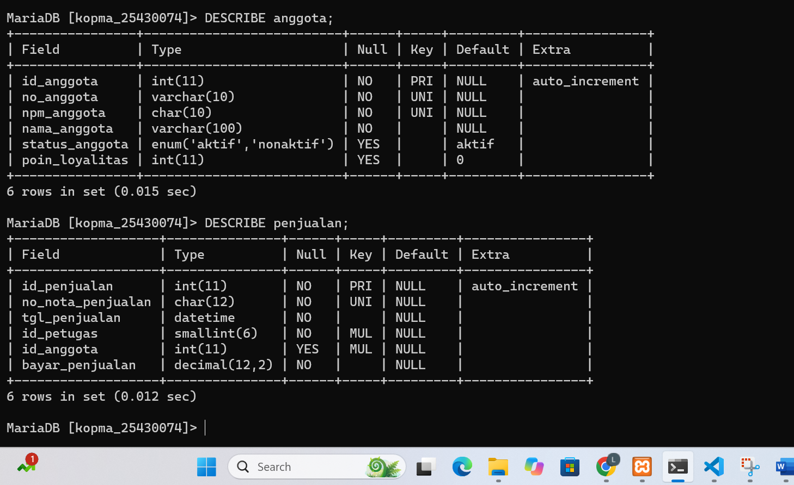

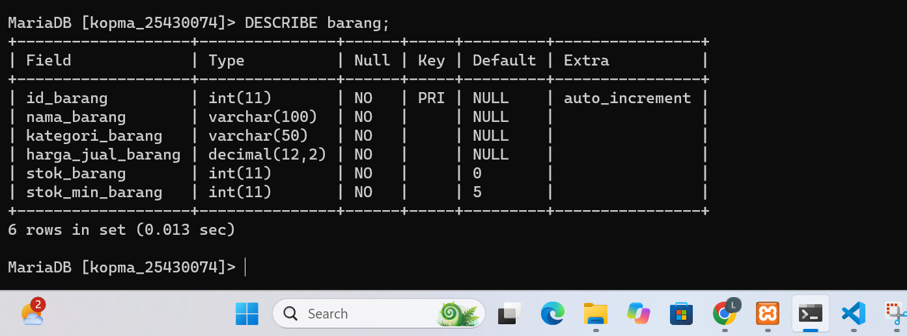

Data lanjutan pada basis data Kopma dimuat dan diverifikasi sebagai dasar pengujian agregasi dan latihan.

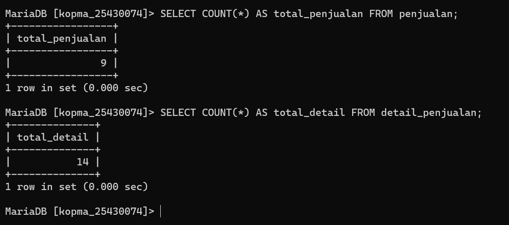

Pada tahap analisis konsep, dilakukan pengujian perilaku `COUNT(DISTINCT ...)` agar jumlah transaksi/nota tidak terhitung ganda saat digabung dengan tabel detail.

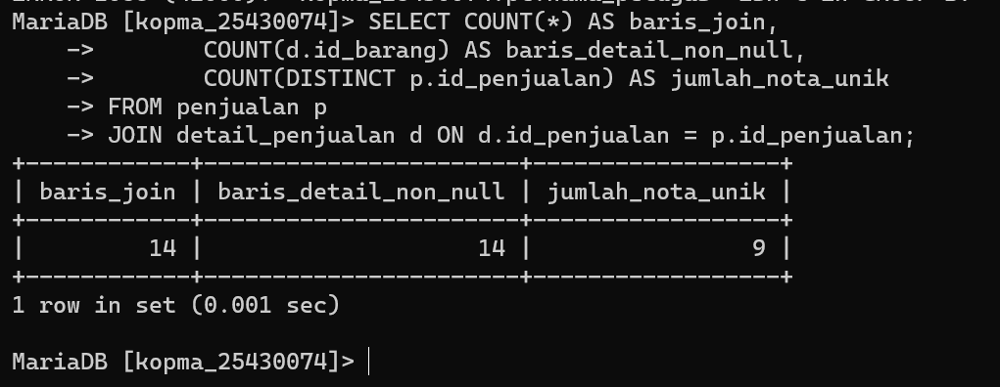

Pengujian aturan `ONLY_FULL_GROUP_BY` dilakukan untuk melihat bagaimana MariaDB menuntut kesesuaian kolom non-agregat pada `SELECT` dan `GROUP BY`, disertai pengecekan ringkasan pengaturan `sql_mode`.

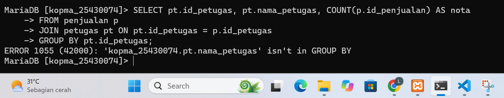

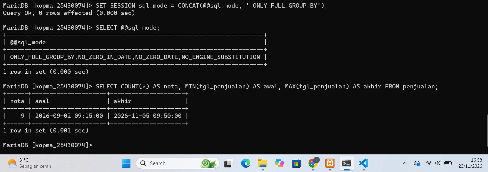

Perbedaan penyaringan data sebelum dan sesudah agregasi diuji melalui perbandingan klausa `WHERE` dan `HAVING`.

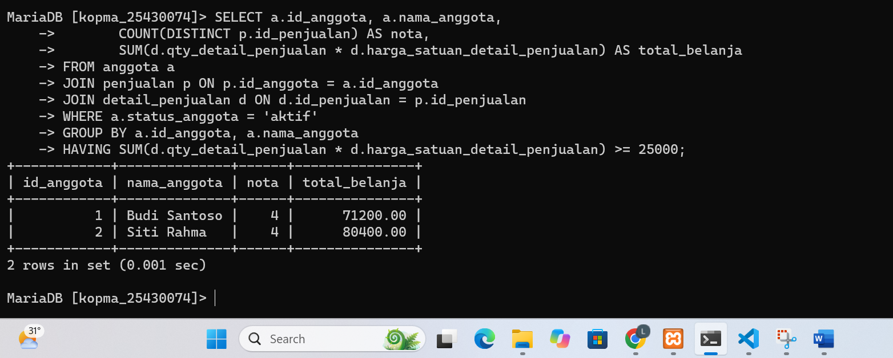

Kueri perhitungan total nilai untuk satu nota diuji untuk memastikan ketepatan perkalian kuantitas dan harga satuan.

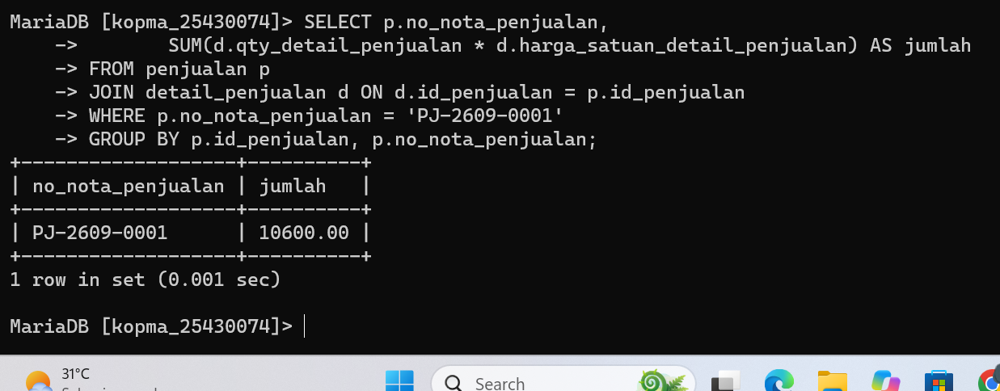

Selain itu, rekap omzet harian dengan `WITH ROLLUP` dijalankan untuk melihat pembentukan baris subtotal dan grand total.

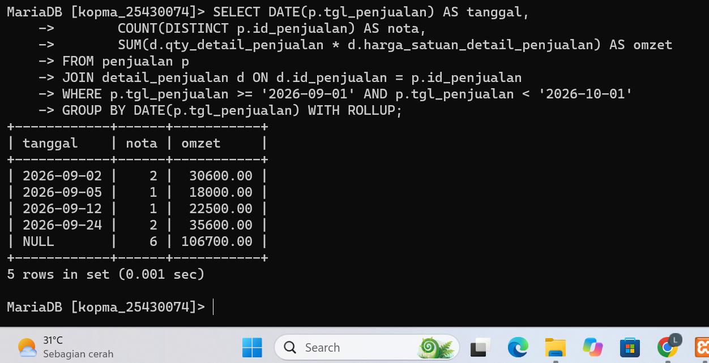

Pada bagian latihan dan modifikasi Kopma, kueri pertama menghitung total nota dengan diskon 5% untuk anggota aktif (`AB-02`), membandingkannya dengan `bayar_penjualan`, dan menyaring nota dengan kembalian lebih dari Rp4.000.

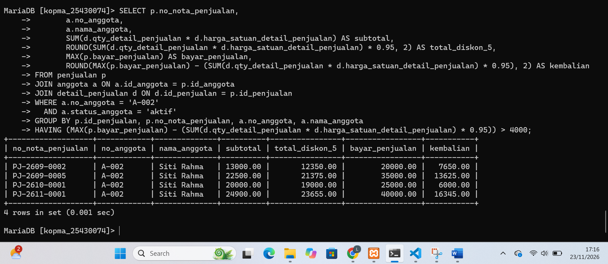

Latihan kedua menampilkan omzet per kategori barang per bulan menggunakan `WITH ROLLUP` beserta analisis makna baris `NULL` yang muncul.

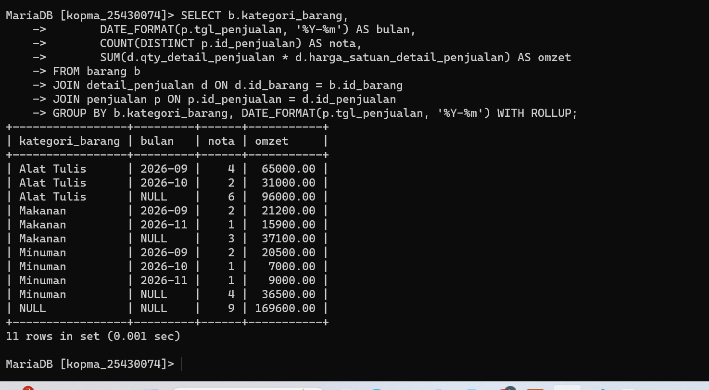

## 6. Hasil Implementasi Milestone Proyek 9 (`toko_074`)

Sebelum menjalankan kueri agregasi pada `p09_agregasi_25430074.sql`, dilakukan pengecekan tabel dan data awal serta penambahan data pesanan berstatus `'Batal'` (`NOTA-2609-031`) agar status pembayaran mencakup minimal tiga kelompok (`Lunas`, `Pending`, `Batal`).

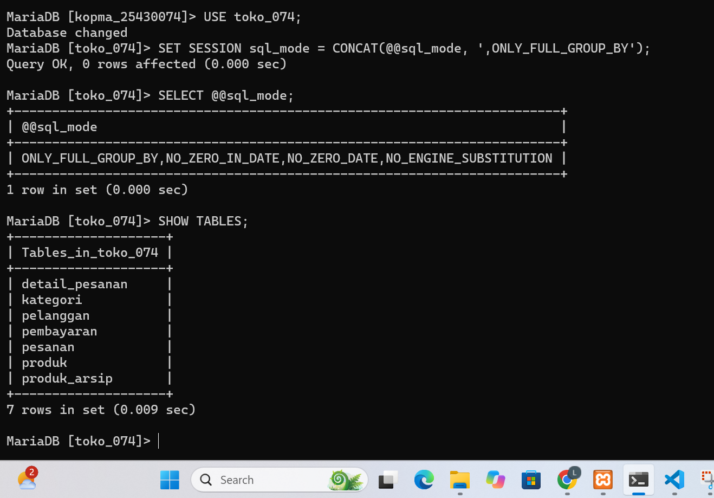

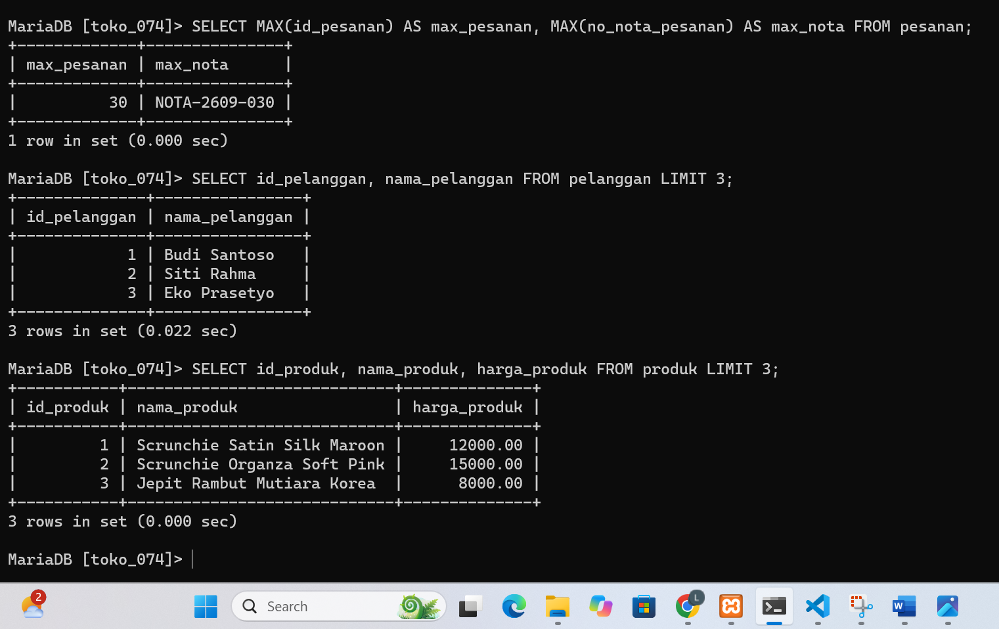

Kueri `[KI-01]` (rekap penjualan per kategori produk) dan `[KI-02]` (rekap pesanan berdasarkan status pembayaran) dijalankan untuk melihat ringkasan jumlah pesanan, total item, dan total nilai transaksi.

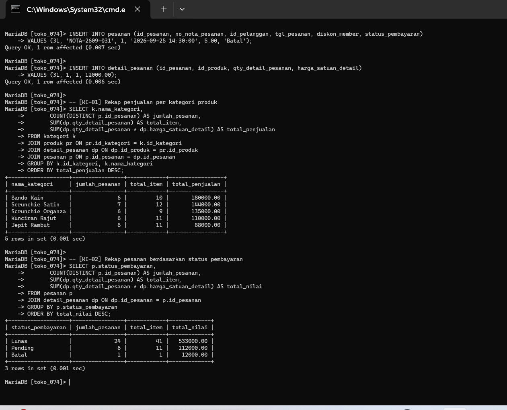

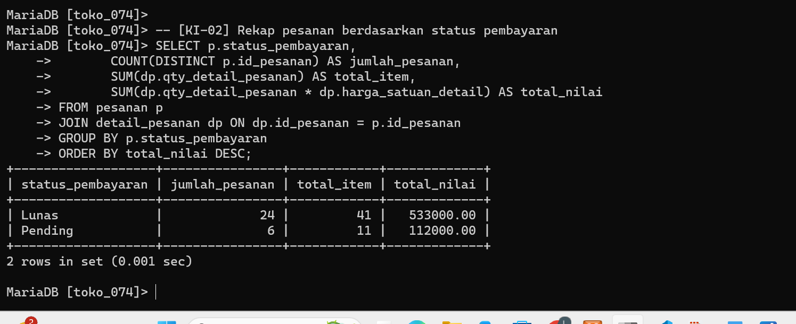

Selanjutnya, kueri `[KI-03]` menyaring performa produk dengan total item terjual minimal 2 menggunakan `HAVING`, sedangkan `[KI-04]` menyajikan rekap penjualan per kategori per bulan dengan `WITH ROLLUP` hingga grand total.

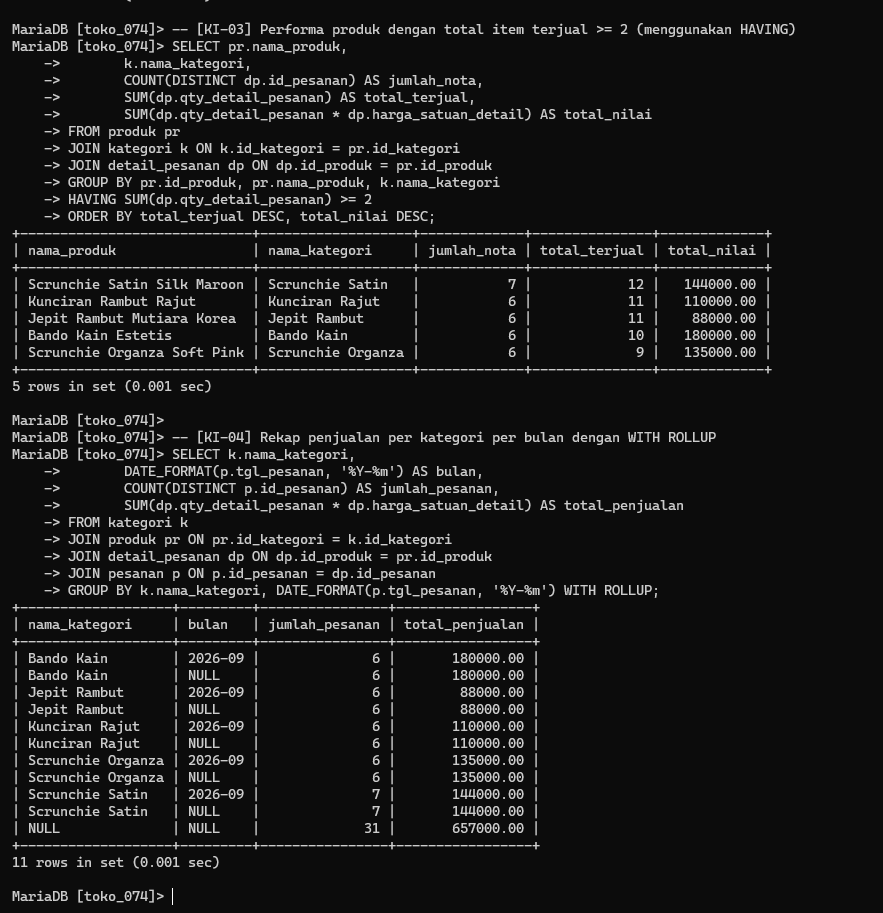

Terakhir, kueri `[KI-05]` menampilkan rekap total belanja per pelanggan yang diurutkan dari nilai belanja tertinggi.

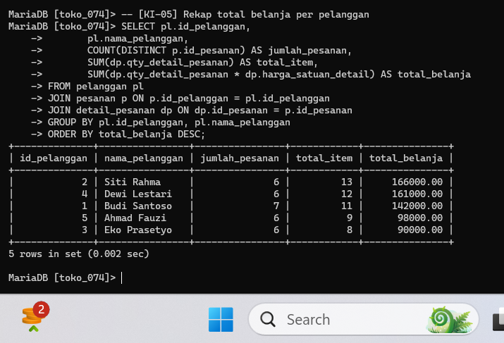

## 7. Jawaban Pertanyaan Refleksi & Analisis Modul 9

### 1. Peran `COUNT(DISTINCT ...)` saat Melakukan `JOIN` ke Tabel Detail

* Saat tabel induk (seperti pesanan/nota) di-`JOIN` ke tabel detail item, satu nota yang memuat beberapa item akan muncul pada beberapa baris hasil join.

* Menggunakan `COUNT(DISTINCT id_pesanan)` memastikan jumlah nota/transaksi yang dihitung tetap sesuai jumlah nota unik, bukan jumlah baris detail produk.

### 2. Dampak `ONLY_FULL_GROUP_BY` terhadap Penulisan Kueri `GROUP BY`

* Dengan `ONLY_FULL_GROUP_BY` aktif, kolom yang tidak diagregasi pada klausa `SELECT` harus disertakan di `GROUP BY` (atau bergantung secara fungsional pada kunci yang dikelompokkan).

* Hal ini mencegah hasil yang ambigu/acak ketika satu kelompok memiliki beberapa nilai berbeda pada kolom yang tidak ikut dikelompokkan.

### 3. Perbedaan `WHERE` dan `HAVING`

* `WHERE` diterapkan pada baris data mentah sebelum proses pengelompokan (`GROUP BY`) dan fungsi agregasi dijalankan.

* `HAVING` diterapkan setelah pengelompokan dan perhitungan fungsi agregasi selesai, sehingga cocok untuk membatasi kelompok berdasarkan hasil `SUM`, `COUNT`, atau `AVG`.

### 4. Interpretasi Baris `NULL` pada `WITH ROLLUP`

* Pada kueri `GROUP BY` bertingkat dengan `WITH ROLLUP`, nilai `NULL` pada kolom pengelompokan yang lebih spesifik (misalnya kolom bulan saat dikelompokkan per kategori lalu per bulan) menandakan baris **subtotal** untuk kelompok induknya.

* Nilai `NULL` pada seluruh kolom pengelompokan menandakan baris **grand total** dari keseluruhan data yang diagregasi.

## 8. Pembahasan dan Kendala

* **Pembahasan Agregasi & Pelaporan:** Penggunaan `GROUP BY`, `HAVING`, `COUNT(DISTINCT ...)`, dan `WITH ROLLUP` memungkinkan basis data `toko_074` menghasilkan ringkasan operasional yang siap dibaca untuk kebutuhan evaluasi penjualan tanpa harus melakukan rekap manual di aplikasi.

* **Kendala yang Dihadapi & Solusi:** Perlu kehati-hatian saat menjalankan ulang skrip yang menyisipkan data uji baru (`NOTA-2609-031`) agar tidak terjadi duplikasi data atau pelanggaran kunci jika baris tersebut sudah ada di tabel. Selain itu, penamaan berkas tangkapan layar perlu diperhatikan agar konsisten dan mudah ditautkan saat menyusun laporan.

## 9. Kesimpulan

Modul Pertemuan 9 telah selesai dilaksanakan mencakup percobaan dan latihan agregasi Kopma pada `p09_agregasi_kopma_25430074.sql` serta implementasi kueri agregasi `[KI-01]`–`[KI-05]` pada basis data `toko_074` melalui `p09_agregasi_25430074.sql`. Seluruh kueri agregasi telah diuji dan didokumentasikan bukti tangkapan layarnya untuk mendukung penyusunan laporan praktikum.

## 10. Pernyataan Penggunaan AI

Mencantumkan dialog interaktif bersama AI Gemini dalam membantu memeriksa kelengkapan tugas Modul 9, memverifikasi hasil pengecekan data di MariaDB, serta menyusun struktur laporan praktikum Modul 9 beserta penempatan kode bukti tangkapan layar.

## 11. Bukti Git

Tautan Repositori: https://github.com/laelinhdytrhma18-cell/basisdata_25430074

Hash Commit File Modul 9: 276c969
Hash Commit Laporan Modul 9: f6ab647

Checklist Verifikasi Mandiri Modul 9

\[x\]
Berkas `p09_agregasi_kopma_25430074.sql` berisi percobaan serta Latihan #1 dan #2.

\[x\]
Berkas `p09_agregasi_25430074.sql` berisi kueri agregasi `[KI-01]`–`[KI-05]` untuk `toko_074`.

\[x\]
Kode gambar bukti tangkapan layar (``) telah ditambahkan pada bagian yang sesuai di laporan Modul 9.

\[ \]
Hash commit terbaru dan tautan berkas di repositori GitHub sudah dilengkapi sebelum pengumpulan akhir.